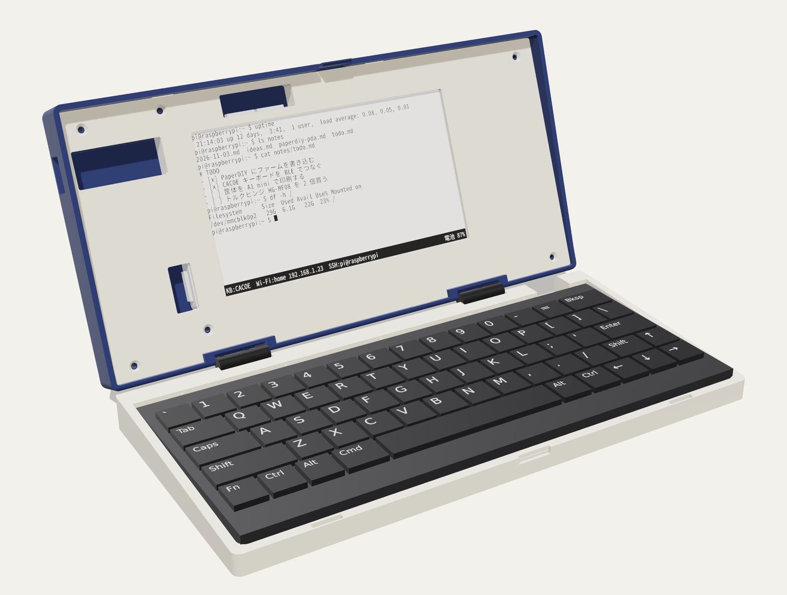
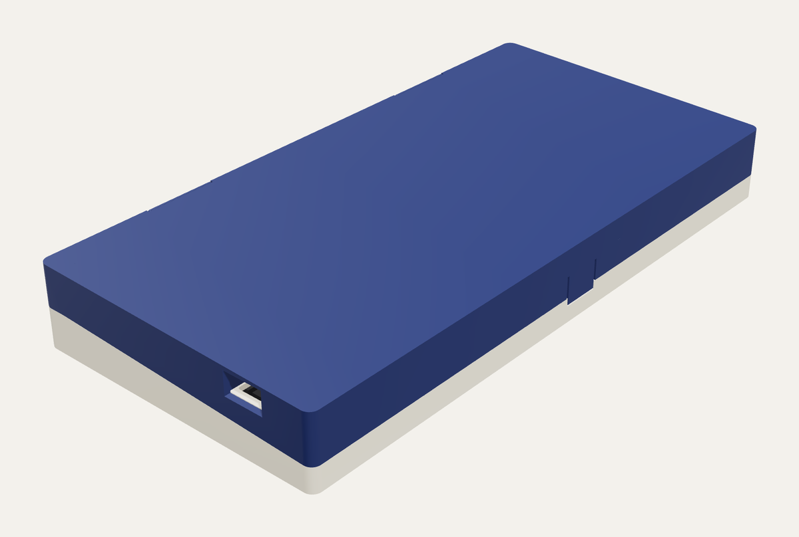
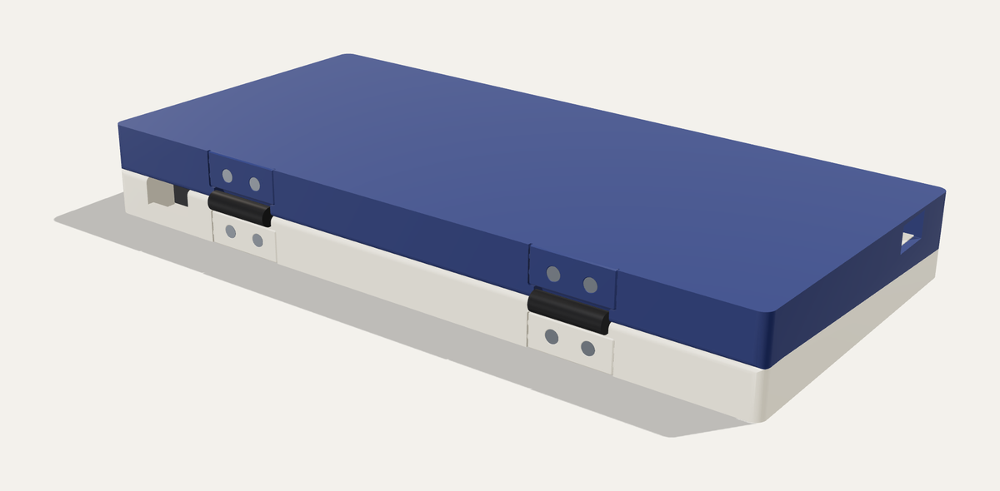
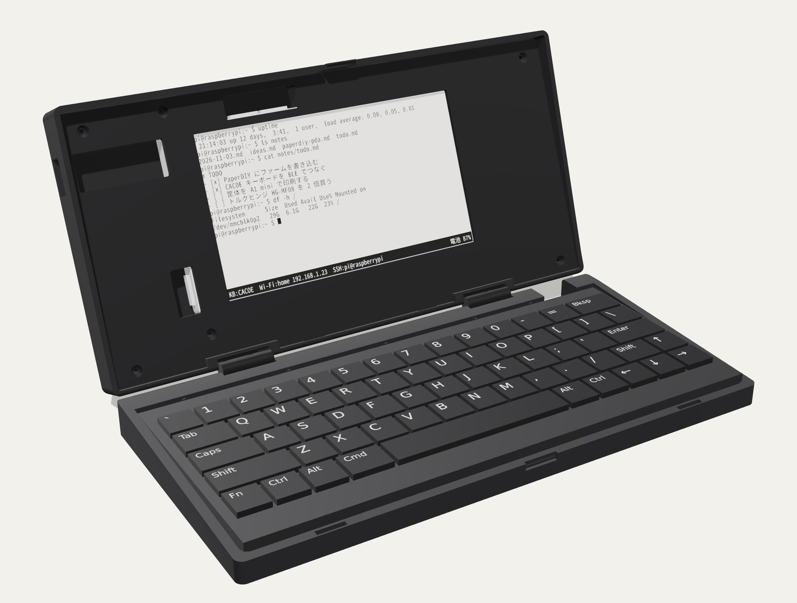
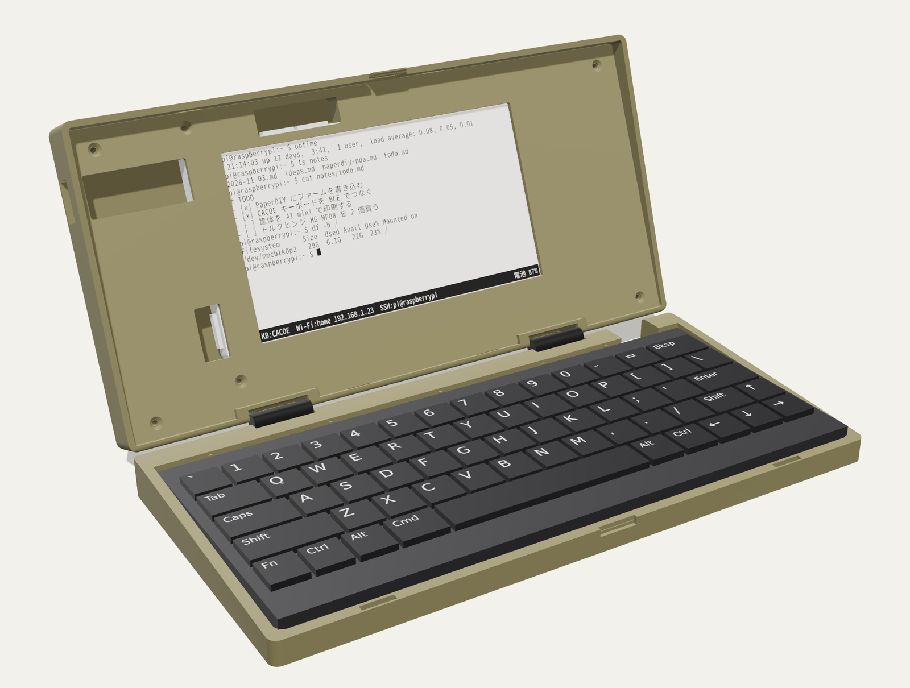
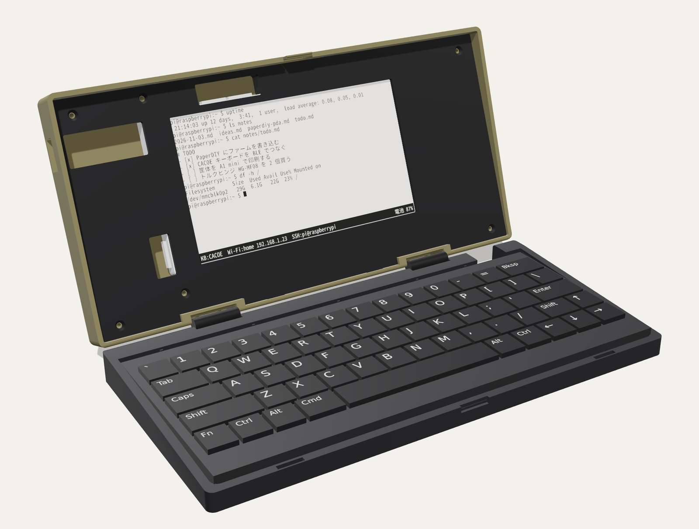
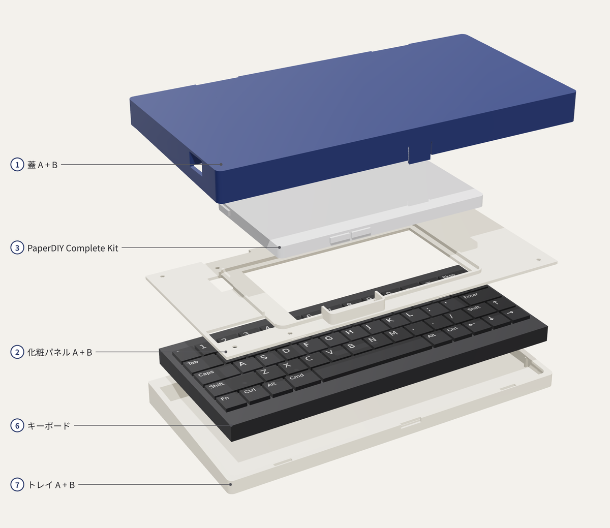

# PaperDIY PDA Terminal

M5Stack PaperDIY（4.7 型 e-paper、ESP32-S3）を画面に、CACOE キーボードを BLE でつないだ、PDA 風クラムシェルの SSH 端末です。Un Kyu Lee さんの [phone-enclosure](https://github.com/unkyulee/phone-enclosure)（Boox Palma 2 + CACOE キーボード）を元にしています。

*English:* a clamshell SSH terminal with an M5Stack PaperDIY (4.7" e-paper, ESP32-S3) as the screen and a CACOE
keyboard over BLE, in a 3D-printed case derived from Un Kyu Lee's phone-enclosure. The firmware (ESP-IDF, reproducible
build) pairs the keyboard by itself, joins Wi-Fi and runs an SSH terminal; the case prints on a Bambu Lab A1 mini (split)
or in one piece on a 220 mm bed. CAD details in English: [cad/README.md](cad/README.md); the assembly guide and the
firmware notes are in Japanese.



<p align="center"> </p>

筐体は `cad/out` の STL を組み立てた状態で描いています（キーボードは CACOE の代わりの簡易モデル、画面の表示はイメージ）。色は黒だけ・カーキだけ・ミックス（蓋がカーキ、トレイと化粧パネルが黒）で描いたものもあります：

<p align="center">  </p>

> **試作段階です。** ファームは実機の PaperDIY で動いています（画面の表示、CACOE キーボードの BLE 接続と自動ペアリング、Wi-Fi、Raspberry Pi への SSH ログインまで確認）。筐体は前の版（PaperDIY の基板をそのまま載せる版）を印刷して組み、キーボードのがたつきや開いたときのすき間などを直しました。今の版（Complete Kit のケースごと入れる中空の蓋と化粧パネル）も、壁 1.2 mm のときに一部を刷って組み、壁の柔らかさ・留めツメの長さ・カバーと継ぎ板のきつさを直しました。直したあとの版はまだ刷っていません。

## 特徴

**端末（ファーム）**

- BLE キーボードで入力。ペアリング待ちのキーボードを自分で見つけてつなぎ、次からはキーを押せば再接続
- Wi-Fi の検索・保存・自動再接続、SSH の接続先 8 件（パスワード、キーボードインタラクティブ、microSD の秘密鍵）
- xterm 互換の端末（UTF-8、日本語の全角表示、スクロール領域、代替画面）。vim、less、top、nano、tmux を想定。日本語の入力は未対応（[Issue #1](https://github.com/tsuyoshi-otake/paperdiy-pda-terminal/issues/1)）
- 接続エラーには、つなぎに行った IP とポート、この端末の IP を表示
- ESP-IDF v5.5.6 の再現可能ビルド。ビルド済みのファームはブラウザからでも書き込める

**筐体**

- Bambu Lab A1 mini と PLA で刷る前提の作り：蓋とトレイは壁・天板・床とも 2.0 mm の殻にして（1.2 mm では刷ってみて柔らかすぎた）、ねじのボスとリブで補強。面取りなし、サポート不要。0.4 mm ノズル向き（0.2 mm ノズルの設定もある）
- トレイは、キーボードのまわりのすき間と奥の帯を、縁と面一の天板（デッキ）でふさいである。ヒンジのボスやリブは隠れる。キーボードはリブで片側 0.15 mm に止まり、ガタつかない（寸法はいまは推定の 194 × 85 mm。実物を測って `KB_SIZE` を直す。少し大きければリブの先を削れば入る）
- PaperDIY は Complete Kit のケースに入れたまま、中空の薄い蓋に入れ、画面の窓のある化粧パネルで押さえる。パネルは押し込むとパチンと留まり（ねじなしでもある程度保持）、ねじ 6 本で固定。ボタンと USB-C プラグはパネルの切り欠きから。KEY の切り欠きの裏にはごみよけのガード
- 閉じた高さは手前 23.8 mm・奥 26.4 mm（TPU の足を入れて 24.2 / 26.8 mm）。蓋と一体の短い留めツメ（幅 12 mm、合わせ目から 2.2 mm）でパチンと閉じる（磁石なし）
- TPU の小物：トレイの底の四隅に滑り止めの足 4 個、手前の縁に、閉じた蓋を軽く押し上げてガタを止めるダンパー 2 個（plate 4、0.4 mm ノズルで約 4 分）
- ヒンジは市販のトルクヒンジ（スガツネ HG-MF08 × 2）を背面に埋め込み、背面と面一のカバーで隠す。カバーは押し込むだけで側面の小さなリブで留まり、ヒンジのねじで共締めするので接着剤は要らない。好きな角度で止まり、開いたときの継ぎ目は 1〜1.5 mm
- USB-C は左端の穴から直接挿す。パネルマウントのメス端子用の蓋も用意（ねじ間隔 16〜30 mm）
- Bambu Lab A1 mini 用の分割版（3 枚で PLA 約 150 g。0.4 mm ノズルで約 3 時間 52 分、0.2 mm ノズルで約 22 時間。継ぎ目はまっすぐ突き合わせ、裏から貼る継ぎ板でつなぐ）と、220 mm 角以上のプリンター用の一体版（0.4 mm ノズルで約 3 時間 41 分・151 g、貼り合わせ不要）
- ねじは M2×8 皿タッピング 14 本だけ。本番の前に試し刷り（0.4 mm ノズルで 22 分、0.2 mm ノズルで約 1 時間 28 分）ではめあいを確かめられる

## 作り方

<p align="center"></p>

1. **測る**：キーボードの厚さ（キートップまで）・幅・奥行き・重さ。厚さで蓋の高さが、幅と奥行きでトレイの大きさが決まります（[組み立てガイドの 3-1](cad/ASSEMBLY_ja.md)）。88 g 以上なら蓋をどこまで開いても後ろに倒れません
2. **試し刷り**：`cad/3mf/plate0_test_coupons.3mf`（0.4 mm ノズルで約 22 分、0.2 mm ノズルで約 1 時間 28 分）で、ヒンジ・留めツメ・カバーのはめあいを確かめる
3. **本番**：A1 mini なら `cad/3mf/plate1_lid.3mf`〜`plate3_panel.3mf`（分割した部品を突き合わせて継ぎ板で貼り合わせる）、大きいプリンターなら `cad/3mf/large/` の 3 枚
4. **ファームを書く**：[`firmware/README.md`](firmware/README.md) の手順で `firmware/prebuilt/` のファームを書き込み、キーボードと Wi-Fi をつないでおく
5. **組み立てる**：ヒンジとカバー、PaperDIY と化粧パネル、キーボードの順に（[組み立てガイド](cad/ASSEMBLY_ja.md)）

## ドキュメント

| 文書 | 内容 |
| --- | --- |
| [cad/ASSEMBLY_ja.md](cad/ASSEMBLY_ja.md) | **組み立てガイド**：部品表、印刷設定、試し刷り、分割版の貼り合わせ、組み立て手順、使うときの注意、確認リスト |
| [cad/README_ja.md](cad/README_ja.md) | 筐体の概要：印刷するファイル、蓋・トレイ・化粧パネル、留めツメ、ヒンジ、倒れやすさ |
| [cad/README.md](cad/README.md) | 筐体の詳細（英語）：寸法の根拠、検査の内容、元の作品からの変更点、全パラメータ |
| [cad/README_bare.md](cad/README_bare.md) | 前の設計（PaperDIY の基板をそのまま載せる版、英語） |
| [cad/bom.csv](cad/bom.csv) | 部品表（CSV） |
| [firmware/README.md](firmware/README.md) | **ファーム**：書き込み、使い方、困ったとき、公開鍵認証、対応する SSH サーバー |
| [firmware/prebuilt/BUILDINFO.md](firmware/prebuilt/BUILDINFO.md) | ビルド済みファームの中身とビルド条件 |
| [docs/README.md](docs/README.md) | 画像と、それを描くスクリプト |
| [CHANGELOG.md](CHANGELOG.md) | 変更の履歴 |
| [Issues](https://github.com/tsuyoshi-otake/paperdiy-pda-terminal/issues) | 課題と検討中のこと |

## リポジトリの構成

| フォルダ | 内容 |
| --- | --- |
| [`firmware/`](firmware/) | PaperDIY 用ファーム（ESP-IDF v5.5.6）。`prebuilt/` にビルド済みのバイナリ |
| [`cad/`](cad/) | 筐体のデータ。`src/`（作るスクリプト）、`out/`（STL）、`3mf/`（印刷用プレート）、`tools/`（検査・レポート） |
| [`docs/`](docs/) | README の画像と、それを描くスクリプト |
| `Makefile`、[`.github/workflows/`](.github/workflows/) | 全部を作り直すコマンドと、push のたびに作り直して確かめる CI |

## まだ確かめていないこと

1. 今の版の筐体の印刷と仮組み（はめあい、留めツメの固さ、ヒンジの筒の太さと軸の高さ。公表値がないので、メーカーの 3D データから太さ 5.5 mm・軸は裏から 3.2 mm と読み取った。合わせ目の縁を丸めたので、軸が 0.3 mm 低くても蓋とトレイが当たるのは 170° から）
2. CACOE の厚さ・幅・奥行き・重さ（いまは厚さ 11.5 mm、幅 194 × 奥行き 85 mm を想定。幅と奥行きは、元のトレイ（196 × 87 mm）で 2 mm ほどガタつくという報告からの推定。測った値を `cad/src/params.py` の `KB_THICK`・`KB_SIZE` に入れて作り直す）
3. トレイの開口から CACOE の充電ケーブルを挿せるか、スイッチに届くか（デッキは開口の上を開けてある。充電ケーブルを挿したままだと蓋は 95° まで）
4. PaperDIY 内蔵の 140 mAh でどれくらい使えるか（足りなければモバイルバッテリー）

## 作り直す・同じものができるか確かめる

```bash
make setup      # Python のパッケージ（バージョン固定）
make verify     # 元データを固定のコミットで取得 → STL と 3MF を作り直し → コミット済みのものと比べる
make report     # 印刷時間・重さ・スライサーの警告・壁の厚さ・倒れやすさ（PrusaSlicer が要る）
make test       # ファームの端末エミュレータのテスト（g++ と pyte）
make firmware   # ESP-IDF v5.5.6 でビルドして prebuilt/ と 1 バイトずつ比べる（Docker なら make firmware-docker）
make render     # README の画像を描き直す（Node.js）
```

- 元データ（phone-enclosure）はコミットと SHA-256 で固定しています。Python のパッケージ、ESP-IDF、ファームの依存ライブラリ、画像を描く npm パッケージもバージョンを固定しています
- 筐体の出力（STL・3MF）は、同じ PC なら 1 バイトも違わないものができます。別の PC では計算の最後の桁の丸めで一部のファイルのバイトが変わることがありますが、形（体積・寸法）は一致します。全ファイルの SHA-256 と体積・寸法を `cad/out/MANIFEST.json` に記録してあり、`make verify` は 0.01 mm / 0.01 % の差まで許して比べます
- ファームは日時やパスを含めない再現可能ビルドで、push のたびに GitHub Actions の `espressif/idf:v5.5.6` コンテナでビルドして `prebuilt/` と 1 バイトずつ比べています

## ライセンス

- **ソースコードと文書は [MIT ライセンス](LICENSE)** です（`firmware/`、`cad/src/`、`cad/tools/`、`docs/` のスクリプト、`Makefile`、CI、Markdown の文書）。
- **筐体の 3D データと、それを描いた画像は [CC BY-NC 4.0（非営利のみ）](cad/LICENSE.md)** です（`cad/out/`、`cad/3mf/`、`cad/renders/`、`docs/images/`）。Un Kyu Lee さんの [phone-enclosure](https://github.com/unkyulee/phone-enclosure)（[CC BY-NC 4.0](https://creativecommons.org/licenses/by-nc/4.0/)）の改変物なので、MIT にはできません。変更点は [`cad/README.md`](cad/README.md#changes-vs-the-original-for-the-licence-indicate-changes) にあります。
- **ビルド済みのファーム**（`firmware/prebuilt/`）には、ビルド時に取得するライブラリ（M5GFX・M5Unified：MIT、LovyanGFX：FreeBSD、efont：BSD 系、libssh2：BSD-3-Clause、ESP-IDF：Apache-2.0 ほか）が入っています。著作権表示とライセンス本文は [`firmware/prebuilt/THIRD_PARTY_NOTICES.md`](firmware/prebuilt/THIRD_PARTY_NOTICES.md) にあります。
- M5Stack、PaperDIY、スガツネ（HG-MF08）、CACOE はそれぞれの会社の名称です。このプロジェクトはどの会社とも関係ありません。
