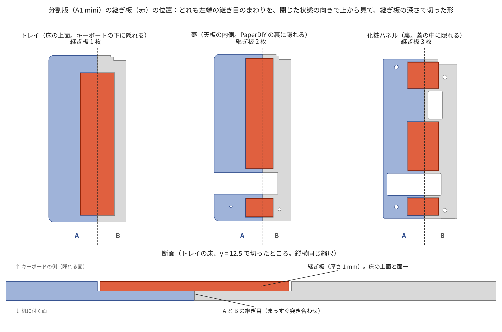
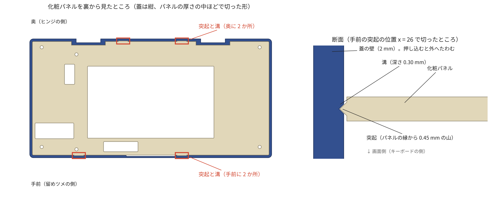

# 組み立てガイド（部品表・印刷・組み立て）

PaperDIY PDA 筐体を Bambu Lab A1 mini で刷って組み立てる手順です。PaperDIY は **Complete Kit のケースに入れたまま**、中空の薄い蓋に入れ、画面の窓のある**化粧パネル**で下から押さえてねじで留めます。電池はキットに入っている 140 mAh の LiPo をそのまま使い、足りないときは USB-C にモバイルバッテリーをつなぎます。閉じた蓋は、蓋と一体の**留めツメ**がトレイに掛かって開かなくなります（磁石は使いません）。

A1 mini と PLA で刷る前提で、蓋とトレイは壁・天板・床とも 2.0 mm の殻にしてあります（ねじのボスとリブで補強。面取りなし）。1.2 mm の版は刷ってみて柔らかすぎました。

**刷って組むたびに出た問題（壁の柔らかさ、ヒンジの戻りで蓋が浮く、留めツメが外れる、キーボードの位置決めリブが当たる、TPU の足が作りにくい、など）を直してきた版です。実機が 1 台組み上がって動いていますが（2026-11-11、留めツメを直す前の版）、直したあとのいまの版そのものは、まだ刷って確かめていません。** 本番の前に 25 分ほどの試し刷りで、はめあいと留めツメの留まり具合を確かめられるようにしてあります。

## 1. 部品表

図の番号と同じです。表計算ソフトで開ける CSV 版：[bom.csv](bom.csv)

| 番号 | 部品 | 数 | 種類 | 注意 |
| --- | --- | --- | --- | --- |
| 1 | 蓋 A・B | 1 組 | 印刷 | 蓋 A（左端の小片）は、USB-C の付け方で選ぶ（2-3）。一体の版では 1 個（2-4） |
| 2 | 化粧パネル A・B | 1 組 | 印刷 | 画面の窓、ボタンを押す切り欠き付き |
| 3 | M5Stack PaperDIY Complete Kit | 1 | 購入 | **ケースに入れたまま**使う。電池も付属の 140 mAh のまま |
| 4 | トルクヒンジ スガツネ HG-MF08 | 2 | 購入 | 白 -WT でも黒 -BL でも可（カバーで隠れる） |
| 5 | ヒンジカバー | 4 | 印刷 | 蓋側 2、トレイ側 2。背面のくぼみに面一にはめ、ヒンジのねじで共締めする |
| 6 | CACOE キーボード | 1 | 購入 | **BLE の HID キーボードとして見えるか**、**重さ**、**寸法**を先に確かめる（3-1） |
| 7 | トレイ A・B | 1 組 | 印刷 | |
| – | 継ぎ板 | 6 | 印刷 | **分割版だけ**。蓋 2・トレイ 1・化粧パネル 3。継ぎ目を裏から貼る（3-3） |
| 8 | **M2×8 皿タッピングねじ**（樹脂用 1 種 または B タイト） | **14** | 購入 | ヒンジ 8（カバーごと留める）、化粧パネル 6。下穴（φ1.8）は印刷済み |
| – | USB-C ケーブル | 1 | 手持ち | 充電・書き込み用。**まっすぐなプラグ**で、根元の太い部分が幅 12 mm × 厚さ 6.5 mm 以内 |
| – | USB-C パネルマウント延長ケーブル | 1 | 任意 | あとから左端をメス端子にするとき（2-3） |
| – | 瞬間接着剤（ゼリー状）またはエポキシ | 少し | 購入 | 継ぎ目と継ぎ板（分割版だけ） |
| – | はがせる薄い両面テープ | 少し | 任意 | キーボードがトレイの中で動くのが気になるとき（3-6） |
| – | microSD カード | 任意 | 購入 | SSH の秘密鍵を置くとき |

ねじは **M2×8 皿タッピングねじ 1 種類だけ**です。

**工具**：プラスドライバー（#0 か #1）、ニッパー、平やすり、ノギス（キーボードの寸法）、キッチンスケール（キーボードの重さ）。

## 2. 印刷（Bambu Lab A1 mini、または大きいプリンター）

`3mf/` のファイルを Bambu Studio で開きます。部品はすでに印刷する向きで 180 × 180 mm のプレートに並んでいます。造形範囲が 220 mm 角以上のプリンター（Bambu Lab A1・P1・X1 など）なら、分割しない一体の版（2-4）も使えます（Bambu Studio 以外で作ったファイルなので、開くときに「ジオメトリのみ読み込む」旨の確認が出ることがあります）。**サポートはどれも要りません。**

### 2-0. いちばん簡単な方法：設定入りのプロジェクトを開く（A1 mini・0.4 mm ノズル）

`3mf/bambu_a1mini/` に、同じプレートを **Bambu Studio のプロジェクト**にしたものがあります（`bambu_plate0_test_coupons.3mf` 〜 `bambu_plate3_panel.3mf`。形だけのファイルと取り違えないよう、名前の頭に `bambu_` を付けてあります）。Bambu Studio（2.0 以降）の「ファイル → プロジェクトを開く」で開くと、プリンタ・プロセス・フィラメントが選ばれた状態になるので、あとは「スライス」して「印刷」するだけです。

| 欄 | 開いたときの状態 |
| --- | --- |
| プリンタ | Bambu Lab A1 mini 0.4 nozzle |
| プレート | Textured PEI Plate |
| フィラメント | Bambu PLA Basic |
| プロセス | 0.20mm Standard @BBL A1M から 5 か所を変えたもの：壁のループ数 3、インフィルのパターン ジャイロイド、壁面生成器 Arachne、象足補正 0.1 mm、正確な Z の高さ オン |

- **開いたら、この 4 つの欄が表のとおりか確かめてください。**変えた 5 か所は、プロセスの設定で色付きで表示されます。このファイルは Bambu Studio の読み込み処理（公開されているソース）に合わせて作ったもので、作る側の環境では Bambu Studio を動かして確かめられていません
- フィラメントやプレートが手元のものと違うときは、そこだけ選び直します
- すでに別のプロジェクトを開いているところへドラッグすると、読み込み方を聞かれます。「プロジェクトとして開く」を選びます（「形状だけ」を選ぶと設定は入りません）
- ファイルに入っているのは、プリセットの名前と、変えた 5 か所の値だけです。それ以外（開始 G-code、速度、温度など）は、手元の Bambu Studio の標準プリセットがそのまま使われます
- **うまく入らないとき**（欄が表のとおりにならない、古い Bambu Studio で警告が出る、など）：`3mf/` の形だけのファイルを開き、同じフォルダの `paperdiy_process_a1mini_04.json` を「ファイル → インポート → 設定のインポート（Import Configs）」で取り込んで、プロセスの一覧から「PaperDIY PDA 0.20mm @BBL A1M」を選びます。同じ 5 か所が入ったプロセスです

### 2-0b. 自分で設定する場合（ほかのプリンタ、0.2 mm ノズルなど）

`3mf/` 直下と `3mf/large/` のファイルには印刷設定が入っていません。開いたらノズルに合わせて次のように選びます。

**0.4 mm ノズル**（標準。作者の A1 mini もこれで刷ります。上の 2-0 のファイルと同じ設定です）

- プリンタ：A1 mini、0.4 mm ノズル ／ プレート：テクスチャ PEI ／ フィラメント：PLA ／ プロセス：0.20mm Standard @BBL A1M
- そこから次を変えます
  - **壁のループ数：3**（ねじの下穴のまわりを厚くして、ねじが効くようにする）
  - **インフィル：15%、ジャイロイド**
  - **壁面生成器：Arachne**（留めツメのまわりの 1.1 mm の帯、1.0 mm のツメ、1.2 mm のリブ・ガードを、すき間なく埋める）
  - **象足補正：0.1 mm**（見える面が 1 層目になるので、窓や切り欠きの縁がはみ出さないようにし、蓋とのすき間 0.2 mm を保つ）
  - **正確な Z の高さ：オン**（化粧パネルの厚さ 1.6 mm と、継ぎ板のくぼみ 0.6・0.8 mm を正確に出す。プライムタワーについての確認が出たら「はい」。1 色なのでタワーは出ません）
- サポート：なし ／ ブリム：**自動**（標準のまま。細い試し刷りの小片にだけ付きます）
- Bambu Studio は変えた設定を開いている間は次のファイルにも引き継ぎます。保存したプロジェクトにも入ります
- **この組み合わせで刷れることは確かめてあります**：各プレートを 0.4 mm ノズル・0.2 mm 積層・Arachne でスライスし、ノズルの通り道をモデルと 1 層ずつ比べました。細すぎて刷られない形や、薄い壁の中のすき間はありません。刷られないのは、ヒンジカバーの側面の小さなリブのいちばん低い 1 層（残りの 3 層は刷られ、押し込みの効きは変わらない）と、0.5 mm² 以下の点だけです（`out/print_report.md` の「Does the 0.4 mm nozzle print everything?」）

**0.2 mm ノズル**（細かく刷りたいとき。時間は 5〜6 倍かかります。化粧パネルの前の版はこの設定で印刷に出しました）

- プリンタ：A1 mini、0.2 mm ノズル ／ プレート：Cool Plate（SuperTack）／ フィラメント：PLA Basic ／ プロセス：0.14mm Extra Draft @BBL A1M 0.2 nozzle
- 「品質」タブの象足補正・正確な Z の高さ・壁面生成器は、0.4 mm ノズルと同じに変えます
- ほかはプロセスの標準のままです（壁 4 周、上 7 層・下 5 層、インフィル 15%、サポートなし、ブリム自動）。化粧パネルは上下の面がつながって、中まで詰まります

### 2-1. まず試し刷り（plate 0、0.4 mm ノズルで約 24 分・10 g、0.2 mm ノズルで約 1 時間 55 分・11 g）

`plate0_test_coupons.3mf` は、本番の部品から**同じ向きのまま切り出した小片**です。プリンタごとのはめあいの差を、長い印刷の前に確かめられます。小片は完成品には使いません（ヒンジカバー 2 枚は本番と同じ部品なので、合えば予備になります）。

| 小片 | 確かめること | 合わないとき（`src/params.py` を変えて作り直す） |
| --- | --- | --- |
| ヒンジ（トレイ側・蓋側の 2 個） | 本物の HG-MF08 とカバーを付けて M2×8 で締め、板が溝に収まる、カバーが背面と面一になる、筒がこすらずに回る、ねじが割れずに効く、**閉じた状態から 160° 以上開いても壁同士が当たらない** | 溝がきつい・ゆるい → `HINGE_CLR`、筒が当たる → `HINGE_BARREL_D`、ねじ → `HINGE_PILOT_D`、壁同士が当たる（軸が思ったより低い）→ `HINGE_AXIS_ABOVE_BACK` |
| 留めツメ（蓋側・トレイ側の 2 個、幅 45 mm） | 蓋側の小片を、トレイ側の小片の手前の壁にかぶせて押し下げる。**カチッと留まり**、指 1 本で押し上げても（300 g ほど）外れず、強く引き上げると外れる。小片は、ツメのまわりの薄い帯を丸ごと含むように切り出してあるので、本体とほぼ同じ手応えです | カチッと言わない・軽く押すと外れる → `LATCH["bump"]`（出っ張り、標準 0.45 mm）を 0.05 mm ずつ上げる。固くて開けにくい → 出っ張りの上側の斜面を紙やすりで少し削るか、`bump` を下げる |
| ヒンジカバー 2 枚 | ヒンジの小片のくぼみに指で押し込めて、ねじなしでも逆さにして落ちない。裏の円すいがヒンジの板の皿穴に入り、ねじの頭がカバーの皿穴に沈む | 押し込めない・すぐ落ちる → `COVER_RIBS["h"]`（リブの高さ、標準 0.35 mm）を 0.05 mm ずつ変えてカバーだけ刷り直す（やすりで削ってもよい）。カバー全体が大きくて入らない → `COVER_POCKET_CLR`（くぼみのすき間、標準 0.25 mm）、円すいが当たってカバーが浮く → `COVER_CSK["cone_d"]` |

データを作り直せないときは、やすりで合わせても構いません。留めツメが固いときは、ツメの内側の出っ張りを紙やすりで少し削ります。

### 2-2. 本番（plate 1〜3、PLA 約 150 g。0.4 mm ノズルで約 4 時間、0.2 mm ノズルで約 22 時間 40 分）

| ファイル | 中身 | 0.4 mm ノズル（時間・PLA） | 0.2 mm ノズル（時間・PLA） |
| --- | --- | --- | --- |
| `plate1_lid.3mf` | 蓋 A・B、蓋側ヒンジカバー 2 枚、蓋の継ぎ板 2 枚 | 1 時間 45 分・65 g | 約 9 時間 53 分・64.9 g（21.4 m）（推定） |
| `plate2_tray.3mf` | トレイ A・B、トレイ側ヒンジカバー 2 枚、トレイの継ぎ板 1 枚 | 1 時間 32 分・62 g | 約 9 時間 11 分・60.5 g（20.0 m）（推定） |
| `plate3_panel.3mf` | 化粧パネル A・B、パネルの継ぎ板 3 枚 | 38 分・24 g | 約 3 時間 33 分・24.3 g（8.0 m）（推定） |
| 合計 | | 3 時間 54 分・151 g | 約 22 時間 37 分・149 g（49.4 m）（推定） |

0.2 mm ノズルの欄は、作者の A1 mini 向けに上の設定で Bambu Studio がスライスした前の版（壁 1.2 mm、2026-11-08。時間はノズルの準備など約 8 分を含む）の値に、PrusaSlicer の 0.2 mm ノズル設定で比べた増え方（plate 0 は時間 1.24 倍・PLA 1.38 倍、plate 1 は 1.43 倍・1.43 倍、plate 2 は 1.60 倍・1.51 倍、plate 3 は 0.96 倍・0.96 倍）を掛けた推定です。細いノズルは 1 本の線が細いので、0.4 mm ノズルの 5〜6 倍の時間がかかります。PLA の量はほぼ同じです。**壁を 2.0 mm にしたので、0.4 mm ノズルで刷るのがおすすめです**（0.2 mm ノズルの細かさが要るのは化粧パネルの窓の縁ぐらいです）。0.4 mm ノズルの欄は、PrusaSlicer に A1 mini に近い設定を入れて出した目安です（`tools/print_report.py`、詳しくは `out/print_report.md`）。Bambu Studio の表示とは多少ずれます。スライサーの注意は、どのプレートにもありません。

蓋は中空の殻（壁・天板とも 2.0 mm）で、天面がプレートに付く向きです。トレイは底がプレートに付く向きです。天面は手前から奥へわずかに傾いた平面ですが、3MF では天面がプレートにぴったり付くように傾きを直してあります。化粧パネルとヒンジカバーは見える面をプレート側にして刷ります（カバーの裏の円すいは上を向きます）。見える面には、プレートの面がそのまま写ります（テクスチャ PEI なら細かい凹凸、Cool Plate SuperTack なら平らな面）。継ぎ板は平らに寝かせて刷り、部品の側の継ぎ板のくぼみはどれも上を向くので、橋渡しもサポートも要りません。

**色の組み合わせ**：完成予想を、黒だけ・カーキだけ・ミックス（蓋がカーキ、トレイと化粧パネルが黒）で描いたものが `docs/images/render_open_black.png` などにあります。

### 2-3. USB-C の付け方を選ぶ（蓋 A）

蓋の左端の小片（蓋 A）だけで、USB-C の付け方が変わります。あとから蓋 A だけを刷り直して付け替えることもできます。蓋 B・化粧パネル・ほかの部品は共通です。

| 付け方 | ファイル | 中身 |
| --- | --- | --- |
| ケーブルを直接挿す（標準） | `plate1_lid.3mf` の蓋 A | 左端の穴から、まっすぐなプラグを PaperDIY の端子まで差し込む。化粧パネルの裏にケーブルの通り道がある |
| パネルマウントのメス端子（ねじ間隔 16 / 18 / 20 / 22 / 25 / 28 / 30 mm） | `usb_variants/lid_A_left_usb○○mm.3mf` | 左端の奥寄りに 13 × 7 mm の開口と M3 のねじ穴。延長ケーブルのオス側は、化粧パネルの切り欠きから PaperDIY の端子に挿し、ケーブルはパネルの裏に収める |
| メス端子を接着で付ける | `usb_variants/lid_A_left_usb_noscrew.3mf` | 開口だけ |

メス端子のねじ耳と本体は、化粧パネルと天板の間に収まる高さ **7.2 mm まで**のものを選んでください。ねじ間隔は、ねじ耳の穴の中心間をノギスで測ります。

### 2-4. 大きいプリンターで刷る（分割なし）

造形範囲が 220 mm 角以上なら、蓋・トレイ・化粧パネルを分割せず一体で刷れます。継ぎ板の貼り合わせ（3-3）が要らず、継ぎ目も出ません。部品はどれも幅 202 mm 以下で、220 × 220 mm のプレートに並べてあります（もっと大きいプレートでは、Bambu Studio で中央に寄せてください）。設定は 2 章のはじめと同じです。

| ファイル | 中身 | 時間の目安 | PLA |
| --- | --- | --- | --- |
| `large/plate1_lid.3mf` | 蓋（一体）、蓋側ヒンジカバー 2 枚 | 1 時間 40 分 | 65 g |
| `large/plate2_tray.3mf` | トレイ（一体）、トレイ側ヒンジカバー 2 枚 | 1 時間 28 分 | 61 g |
| `large/plate3_panel.3mf` | 化粧パネル（一体） | 35 分 | 24 g |
| `large/usb_variants/lid_usb○○mm.3mf`、`lid_usb_noscrew.3mf` | メス端子用の蓋（一体）。2-3 の蓋 A の代わり | 必要なときだけ | |

合計で約 3 時間 42 分・150 g です。試し刷り（plate 0）は同じように刷ってください。

一体の版では、USB-C の付け方を後から替えるときは蓋ごと刷り直します（約 1 時間 10 分・45 g）。

## 3. 組み立て

### 3-1. 印刷・購入の前に確かめる

1. **キーボードが BLE でつながるか**：CACOE は BLE の HID キーボードとしてつながることを確かめてあります（Esc は Fn＋スペース）。別のキーボードを使うときは、スマホの nRF Connect などで HID サービス 0x1812 を広告しているか見てください。ESP32-S3 は Bluetooth Classic に対応しないので、Classic 専用のキーボードはつながりません
2. **キーボードの寸法**：幅・奥行きと、キートップのいちばん上までの厚さをノギスで測ります。化粧パネルの面は、トレイの床（高さ 2.0 mm）＋キーボードの厚さ＋0.5 mm の高さにあります。いまのデータは、元の作品と同じく**キーボードの厚さ 11.5 mm まで**入るように作ってあります。薄ければ `src/params.py` の `KB_THICK` を直して作り直すと、蓋がそのぶん低くなります。**幅と奥行き**は、測らなくても入ります。トレイのキーボードの入る所は元のトレイと同じ **196 × 87 mm** で、内側に出っ張りはありません（元のトレイで前後・左右とも 2 mm ほどガタつくという報告から、キーボードは 194 × 85 mm ほどと推定しています）。CACOE 以外のキーボードを使うときは、196 × 87 mm より小さいことを確かめてください
3. **キーボードの重さ**：蓋を大きく開くと重心が後ろに移るので、キーボードが軽いと後ろに倒れます（4 章）。**83 g 以上**ならどこまで開いても倒れません
4. **USB-C ケーブルのプラグ**：まっすぐなプラグで、根元の太い部分が幅 12 mm × 厚さ 6.5 mm 以内のもの

### 3-2. ファームを書き込む

ケースに入れる前に、PaperDIY に直接 USB-C をつないでファームを書き込み、キーボードと Wi-Fi の設定まで済ませておくと楽です（手順は [`firmware/README.md`](../firmware/README.md)。Python がなくても、Chrome のブラウザ版 ESP Tool で書けます）。組み込んだあとも、蓋の左端の穴から USB-C を挿せば書き込めます。

### 3-3. 分割部品を貼り合わせる（A1 mini 用の分割版だけ）

蓋・トレイ・化粧パネルはどれも左端で 2 つに分かれていて、継ぎ目はまっすぐな突き合わせです。突き合わせ面だけでは継ぎ目が折れやすいので、継ぎ目をまたぐ**継ぎ板**を見えない側に貼って補強します。継ぎ板は A と B の位置合わせも兼ねます。継ぎ板は A と B の両方に彫ったくぼみ（壁の厚さの半分の深さ、板よりまわり 0.3 mm 大きい）にはまり、面一になります（0.15 mm では刷ってみてきつすぎました。板は平らに寝かせて刷るので、1 層目が少し広がります）。厚さは蓋とトレイが 1.0 mm、化粧パネルが 0.8 mm です。貼るまでは、くぼみのところの壁が半分の厚さしかないので、継ぎ目のまわりを曲げないように扱ってください。

| 部品 | 継ぎ板 | 貼る面 |
| --- | --- | --- |
| トレイ | 1 枚（20 × 84.8 mm、厚さ 1.0 mm） | 床の上面（キーボードの下に隠れる。デッキの穴から入れる） |
| 蓋 | 2 枚（16 × 11 mm、16 × 65.5 mm、厚さ 1.0 mm） | 天板の内側（PaperDIY の裏に隠れる）。USB-C の通り道は避けてある |
| 化粧パネル | 3 枚（18.4 × 10〜29 mm、厚さ 0.8 mm） | 裏（蓋の中に隠れる）。USB-C と電源の切り欠きの間 |

1. まず接着剤なしで A と B を突き合わせ、継ぎ板をくぼみに置いてみます。きつければ継ぎ板の縁をやすりで少し削ります
2. 平らな板（ガラスや印刷プレート）の上に、**見える面を下にして**置きます（トレイは底、蓋は天面、化粧パネルは表を下に）。外側の面がそろうように押さえながら、突き合わせ面に接着剤を付けて貼ります
3. そのまま、継ぎ板の裏（くぼみに入る面）に接着剤を薄く広げ、くぼみにはめて指で押さえます。継ぎ板は継ぎ目をまたいで A と B の両方に掛かります。はみ出した接着剤は拭き取ります（トレイの床はキーボードが載るので、盛り上がらないように）
4. 接着剤が固まるまで（瞬間接着剤なら数分、エポキシなら説明書の時間）動かさないでおきます

後で USB-C の付け方を替える（蓋 A を刷り替える）かもしれないなら、**蓋だけは継ぎ目も継ぎ板も接着しない**でおけます。蓋 A は化粧パネルのねじ 2 本（左端の上下）でパネルに留まり、パネルは蓋 B にもねじで留まるので、組み上げれば外れません（継ぎ板は置くだけにするか、使わない）。メス端子用の蓋 A（`usb_variants/`）にも同じくぼみがあるので、刷り替えたあとで貼れます。一体の版（2-4）では、この手順は要りません。

### 3-4. ヒンジとカバーを付ける

1. トレイの上に蓋を閉じて、外周をそろえます。手前の留めツメがトレイのくぼみに入って、パチンと留まります
2. 背面の 2 か所の溝に HG-MF08（④）を入れます。**ヒンジの平らな面（裏）を溝の底に当て、筒が外に出る向き**にします。板は背面より 1 mm 低く（カバーの厚さ分）収まり、筒は背面から 3 mm ほど出ます。溝はヒンジより片側 0.25 mm 大きくしてあります。逆向きだと筒が溝に入らず、板が浮きます
3. ヒンジカバー（⑤）を、板の上のくぼみに指で押し込みます。上が蓋側（色は蓋と同じ）、下がトレイ側です。カバーの裏の円すいがヒンジの板の皿穴に入ります。カバーは背面と面一になり、左右の縁の小さな突起（つぶしリブ）でくぼみに留まるので、ねじを入れる間も落ちません
4. M2×8 皿タッピングねじ（⑧）を、1 つのヒンジにつき 4 本（蓋側 2、トレイ側 2）締めます。合計 8 本です。ねじは背面から、カバーの皿穴とヒンジの板の穴を通して、印刷してある下穴（Ø1.8 mm）に入れます。カバーとヒンジが一緒に留まるので、接着剤は要りません
   - ドライバーは手で回し、まっすぐ入れます。頭がカバーの皿穴に沈んで面一になったところで止め、締めすぎないでください（PLA のねじ山がつぶれ、カバーも割れます）
   - 頭は必ず皿形にします。なべ頭だと頭が背面から出ます
   - **ねじを締めると蓋の手前が開く場合**：蓋とトレイの縁が、ヒンジのそばで先に当たっています（軸のすぐそばなので、0.05 mm の盛り上がりで手前が 3 mm 開きます）。いまの版の蓋は、下面をヒンジに向かって 0.4 mm まで斜めに逃がしてあるので、起きないはずです。前の版の蓋では、蓋の奥の縁（ヒンジのある厚い壁の、トレイに当たる面）を紙やすりで 0.3 mm ほど落とすと同じことになります
5. 蓋を開け閉めして、引っかかりがないか、好きな角度で止まるかを確かめます。背面は全幅がヒンジの面にそろっているので、開いたときの蓋とトレイの継ぎ目は 1〜1.5 mm です。蓋とトレイの背面の、合わせ目に沿った縁は丸めてあります（R1.5。軸の位置が少しずれてもこすれないように）

背面の右寄りにある開口は、キーボードの充電口です（元の作品のまま）。

### 3-5. PaperDIY と化粧パネルを付ける

1. 蓋を 100° くらいまで開き、蓋の内側（中空の側）をこちらに向けます
2. PaperDIY（③）をケースに入れたまま、**画面をこちらに向けて**蓋の中に入れます。**USB-C のある端を左**、**KEY ボタンのある長い辺を上**（蓋の手前の縁の側）にします。裏は天板の 3 本のリブに当たります。microSD を使うなら、先に挿しておきます
3. 化粧パネル（②）をかぶせます。パネルの裏の枠が PaperDIY のまわりに入り、窓が画面にそろいます。手前と奥の縁を指で押し込むと、パネルの縁の小さな突起 4 か所（手前 2、奥 2）が蓋の壁の溝にパチンとはまり、ねじなしでも留まります。外すときは、ボタンの切り欠きに爪をかけて手前の縁から持ち上げます

   

4. M2×8 皿タッピングねじ（⑧）6 本で、パネルを蓋のボスに留めます。頭がパネルの皿穴に沈むところで止めます。PaperDIY はパネルとリブの間に挟まって動かなくなります。突起だけでも普段使いでは外れにくいですが、落としたときなどのためにねじも締めておくのがおすすめです
5. **ボタン**：KEY1・KEY2 はパネルの上の縁寄りの切り欠き、電源は窓の左の切り欠きから、指先で横に押します。KEY の切り欠きのまわりには、パネルの裏に壁（ガード）が立っていて、切り欠きから落ちたごみが蓋の中に入りにくくなっています
6. **USB-C**：蓋の左端の穴から、まっすぐなプラグを差し込みます。化粧パネルの左端に、プラグの通り道を見せる切り欠きがあるので、プラグが端子に入るのを見ながら指で押し込めます。蓋の内側の 2 本のガイドが、穴から端子までプラグを導きます。挿したまま蓋を閉じられます。メス端子の蓋 A のときも、延長ケーブルのオス側をこの切り欠きから抜き差しできます

### 3-6. 仕上げ

1. **キーボード（⑥）**：トレイ（⑦）のデッキの穴から、上から入れます。穴は元のトレイの内側と同じ 196 × 87 mm です。壁から内側に出るものはありません（位置決めのリブは、きつかったのでやめました）。ヒンジのボスなどはデッキの下に隠れます
   - キーボードは位置決めされないので、前後・左右に 2 mm ほど動きます。閉じても蓋はキーボードを押さえない（すき間 0.5 mm の想定）ので、持ち運ぶと中で少し動きます
   - **動くのが気になるとき**：キーボードの裏に、はがせる薄い両面テープを貼って床に留めます
   - **取り出すとき**：手前はキーボードが縁より上に出ているので、手前の縁に指をかけて持ち上げます
   - 充電口とスイッチに元の開口から届くかを確認します。デッキは開口（右奥、幅 16 mm）の上を開けてあるので、プラグは上から入れられます

## 4. 使うとき

- **閉じる**：蓋の手前を、**カチッと音がするまで押し込みます**。蓋の手前の真ん中にある留めツメがトレイのくぼみに入って留まります。蓋を置いただけでは閉じません：トルクヒンジは手を離すと少し戻るので、ツメが掛かっていない蓋は手前が少し浮いたままになります（故障ではありません。ヒンジの軸でのわずかな戻りが、手前では大きく見えます。1° で 1.7 mm）。押し込む力はシミュレーションで、蓋が図面どおりの位置なら約 13 N（1.3 kg）です
- **開ける**：片手で本体（トレイ）を押さえ、もう片方の手で蓋の手前の合わせ目に指先を掛けて持ち上げます。開ける力はシミュレーションで、蓋が図面どおりの位置なら約 18 N（1.8 kg。ツメ 17 N ＋ヒンジの固さ−蓋の重さ）、手前に寄っていればそれ以下です。本体はこの力より軽いので、押さえないと蓋と一緒に持ち上がります。ツメは幅 30 mm で、合わせ目から 2.6 mm だけ下に出ています。固すぎる・すぐ外れるときは 2-1 の表のとおり調整します
- **カチッと言わないとき・閉じてもすぐ開くとき**
  - まずヒンジのねじを少し緩めてみます。それで閉じたままになるなら、蓋とトレイの縁がヒンジのそばで当たっています（3-4 の 4 の「ねじを締めると蓋の手前が開く場合」）
  - 次に、閉じた蓋の手前の面が、トレイの手前の面より前に出ていないかを見ます。シミュレーション（`cad/out/snap_sim.md`、[設計メモ](README_ja.md) の「留めツメ」）では、蓋が 0.3 mm 手前にあるとほとんど留まらず、0.4 mm では出っ張りが溝に届きません。段差が 0.2 mm 以上あるなら、その寸法を測って、その分だけツメの位置を動かしたデータに直します。刷り直さずに試すなら、トレイ側のヒンジの板の下に、段差と同じ厚さの紙をはさむと、蓋が奥へ寄ります（まだ試していません。カバーは紙の厚さだけ背面から出ます）

  

- **開く角度と倒れやすさ**：蓋を 90° より大きく開くと、蓋の重心がトレイの後ろの縁より後ろに出ます。倒れないために必要なキーボードの重さは次のとおりです（蓋側 約 138 g（PaperDIY Complete Kit 43.1 g を含む）、トレイ 約 64 g。`out/print_report.md`。トレイの重心は形の中心で見積もっているので、中身の詰まった奥の帯のぶん、実際より少し厳しめです）。倒れる支点はトレイの底の後ろの縁です。机の上では約 162° で蓋が机に当たり、そこから先は倒れません

  | 開く角度 | 110° | 120° | 130° | 140° | 150° | 162° |
  | --- | --- | --- | --- | --- | --- | --- |
  | 必要なキーボードの重さ | 17 g | 35 g | 52 g | 66 g | 76 g | 83 g |

- **電池**：PaperDIY 内蔵の 140 mAh だけなので、Wi-Fi で SSH をつなぎっぱなしにすると長くはもちません。足りないときは、左端の USB-C にモバイルバッテリーをつなぎます。挿したまま蓋を閉じられます
- **キーボードを充電しながら使うとき**：背面の充電口にケーブルを挿したままだと、蓋は **95° まで**しか開きません（それ以上開くと蓋の背面がプラグに当たります）。開いたときに蓋とトレイの間にすき間ができないよう、背面を全幅でヒンジの面にそろえたためです。キーボードの充電は、蓋を閉じてするのがおすすめです
- **充電ケーブルのプラグ**：根元の太い部分が幅 16 mm × 高さ 6.8 mm 以内なら入ります（元の作品と同じ条件）

## 5. 確認リスト（考慮しきれていない点）

| # | 項目 | 何が起きるか | 確かめ方・対策 |
| --- | --- | --- | --- |
| 1 | キーボードの厚さ | いまのデータは元の作品と同じ 11.5 mm まで入る想定。これより厚いと蓋が閉まらない。薄ければ蓋をもっと薄くできる | 測って `KB_THICK` を直し、作り直す（3-1） |
| 2 | キーボードのガタ | トレイは元と同じ 196 × 87 mm の空間で、位置決めのリブはない（手前と奥のリブは干渉し、左右のリブはきつかったのでやめた）。キーボード（推定 194 × 85 mm）は前後・左右に 2 mm ほど動く | 気になるなら、キーボードの裏をはがせる両面テープで床に留める（3-6）。寸法を測れば、すき間を詰めたトレイも作れる（`KB_FACE_X`・`KB_FACE_Y`） |
| 3 | ~~CACOE が BLE か~~ | 確認済み（BLE の HID キーボードとしてつながる） | 別のキーボードなら nRF Connect などで HID サービス 0x1812 を見る |
| 4 | キーボードの重さ | 軽いと、蓋を大きく開いたときに後ろに倒れる | 量って 4 章の表と比べる |
| 5 | キットのケースの寸法 | M5Stack が公開している 3D データ（120.0 × 67.0 × 6.3 mm）で作った。実物の印刷ケースがずれていると、パネルの枠がきつい・ゆるい | 枠はまわりに 0.2 mm のすき間。きつければ枠をやすりで削る |
| 6 | 留めツメの固さ | プリンタの精度で固さが変わる。ツメに切れ目はなく、まわりの壁（内側から 1.1 mm に薄くした帯）が板としてたわむので、ひずみは広く散る（外へ約 17 N まで耐える計算）。それでも無理にこじると割れることがある。これまでに刷った版は留まらなかった。ヒンジのねじを締めると蓋が開くことが実機で分かり、蓋の下面をヒンジ側で逃がした（これが主な原因だった可能性が高い）。シミュレーションでは、蓋が図面の位置から 0.2 mm 手前までなら留まり、0.4 mm 手前では掛からない | 試し刷り（2-1）の小片で、外れないか・開けにくくないかを確かめる。出っ張りは `LATCH["bump"]`（0.45 mm）。組んだあと留まらないときは 4 章の「カチッと言わないとき・閉じてもすぐ開くとき」 |
| 7 | USB-C のプラグ | 太いプラグや L 字のプラグは穴と通り道に入らない | まっすぐで、根元が 12 × 6.5 mm 以内のケーブルを使う。またはメス端子の蓋 A に替える（2-3） |
| 8 | ヒンジの筒の太さと軸の位置 | 寸法表にはない。スガツネの 3D モデルから筒 約 5.5 mm、軸は裏から約 3.2 mm と読んだ。カバーを面一にしたので、軸は背面の 0.15 mm 外しかない（合わせ目の縁を R1.5 で丸めたので、実物の軸が 0.3 mm 低くても蓋とトレイが当たるのは 170° から） | 試し刷りのヒンジ小片を本物のヒンジとカバーでつなぎ、160° 以上開くか確かめる（2-1） |
| 9 | はめあい | プリンタによって、ヒンジの溝や継ぎ板のくぼみがきつい・ゆるい | 試し刷り（2-1）で確かめてから本番を刷る |
| 10 | キーボードの充電口とスイッチの位置 | 元の作品の開口が CACOE の充電口とスイッチ用だと推定しているだけ | キーボードをトレイに置いて確かめる。違えば `KB_CUTS_ENABLED = True` で開口を追加 |
| 11 | 化粧パネルの突起（ねじなしの留め） | プリンタの精度で、押し込めないほど固い、またはすぐ外れる | 固ければパネルの縁の突起をやすりで少し削るか、`PANEL_SNAP["bump"]`（標準 0.45 mm）を 0.05 mm ずつ下げて化粧パネルだけ刷り直す |
| 12 | 壁の厚さ | 1.2 mm の版は刷ってみて柔らかすぎたので、蓋とトレイの壁・天板・床を 2.0 mm にした。分割版は、継ぎ板を貼るまでくぼみのところが 1.0 mm | 継ぎ板を貼ってから組む。まだたわみが気になる所があれば、リブを足すか `WALL` を上げて作り直す |
| 13 | 分割版の継ぎ目 | 接着が弱いと、継ぎ目で折れる・段差ができる | 継ぎ板を必ず貼る（3-3）。一体の版なら継ぎ目はない |

ほかの作り方も `src/params.py` で選べます。`KIT_LID = "solid"` にすると、中まで詰まった蓋のくぼみに PaperDIY をはめ、天面からねじ 1 本で留める版になります（化粧パネルなし）。`PD_MOUNT = "bare"`（または環境変数 `PD_MOUNT=bare`）にすると、前の設計（Assembly Kit の基板をそのまま画面パネルに載せ、2000 mAh の電池を入れる版）を作れます。その説明は [README_bare.md](README_bare.md)（英語）に、組み立て手順はリポジトリの履歴のコミット `7b0e57d` の版のこのファイルにあります。
