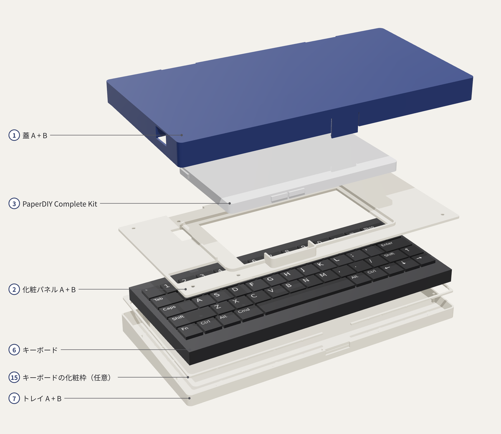
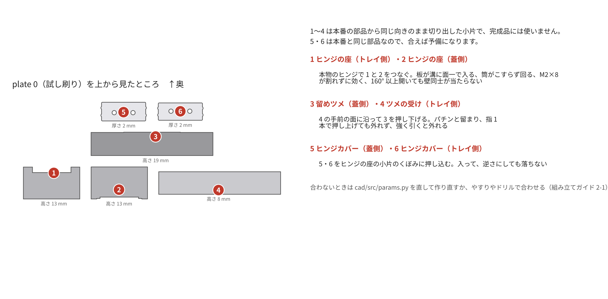
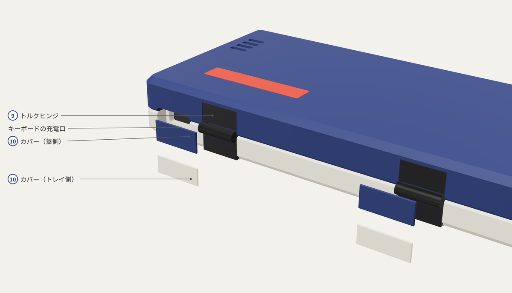
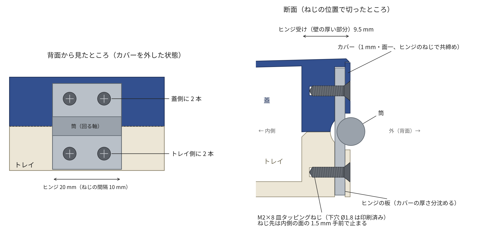
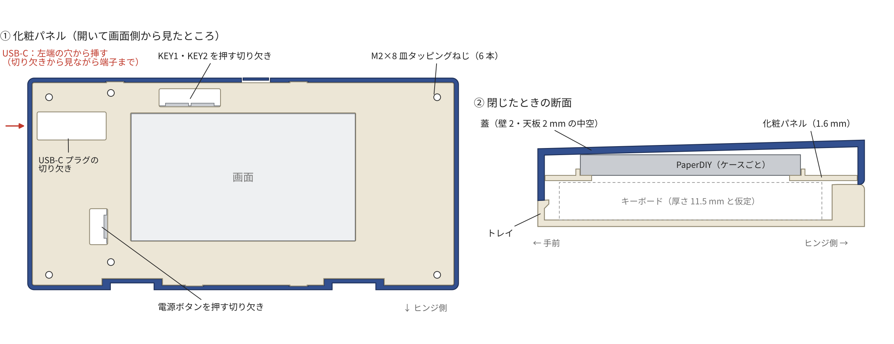
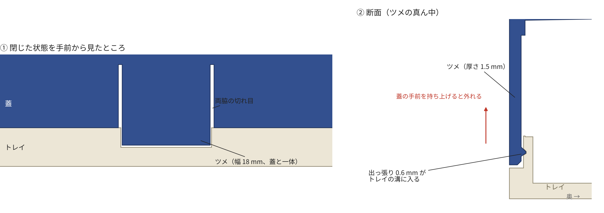

# 組み立てガイド（部品表・印刷・組み立て）

PaperDIY PDA 筐体を Bambu Lab A1 mini で刷って組み立てる手順です。PaperDIY は **Complete Kit のケースに入れたまま**、中空の薄い蓋に入れ、画面の窓のある**化粧パネル**で下から押さえてねじで留めます。電池はキットに入っている 140 mAh の LiPo をそのまま使い、足りないときは USB-C にモバイルバッテリーをつなぎます。閉じた蓋は、蓋と一体の**留めツメ**がトレイに掛かって開かなくなります（磁石は使いません）。

**まだ誰も実物を組んでいません。** 本番の前に 20 分ほどの試し刷りで、はめあいを確かめられるようにしてあります。

## 1. 部品表

図の番号と同じです。表計算ソフトで開ける CSV 版：[bom.csv](bom.csv)

| 番号 | 部品 | 数 | 種類 | 注意 |
| --- | --- | --- | --- | --- |
| 1 | 蓋 A・B | 1 組 | 印刷 | 蓋 A（左端の小片）は、USB-C の付け方で選ぶ（2-3） |
| 2 | 化粧パネル A・B | 1 組 | 印刷 | 画面の窓、ボタンを押す切り欠き付き |
| 3 | M5Stack PaperDIY Complete Kit | 1 | 購入 | **ケースに入れたまま**使う。電池も付属の 140 mAh のまま |
| 4 | トルクヒンジ スガツネ HG-MF08 | 2 | 購入 | 白 -WT でも黒 -BL でも可（カバーで隠れる） |
| 5 | ヒンジカバー | 4 | 印刷 | 蓋側 2、トレイ側 2 |
| 6 | CACOE キーボード | 1 | 購入 | **BLE の HID キーボードとして見えるか**、**重さ**、**寸法**を先に確かめる（3-1） |
| 7 | トレイ A・B | 1 組 | 印刷 | |
| 8 | **M2×8 皿タッピングねじ**（樹脂用 1 種 または B タイト） | **14** | 購入 | ヒンジ 8、化粧パネル 6。下穴（φ1.8）は印刷済み |
| – | USB-C ケーブル | 1 | 手持ち | 充電・書き込み用。**まっすぐなプラグ**で、根元の太い部分が幅 12 mm × 厚さ 6.5 mm 以内 |
| – | USB-C パネルマウント延長ケーブル | 1 | 任意 | あとから左端をメス端子にするとき（2-3） |
| – | 瞬間接着剤（ゼリー状）またはエポキシ | 少し | 購入 | 蟻ほぞ、ヒンジカバー |
| – | 薄い両面テープ | 少し | 購入 | キーボードがゆるいとき |
| – | microSD カード | 任意 | 購入 | SSH の秘密鍵を置くとき |

ねじは **M2×8 皿タッピングねじ 1 種類だけ**です。

**工具**：プラスドライバー（#0 か #1）、ニッパー、平やすり、ノギス（キーボードの寸法）、キッチンスケール（キーボードの重さ）。

## 2. 印刷（Bambu Lab A1 mini、または大きいプリンター）

`3mf/` のファイルを Bambu Studio で開きます。部品はすでに印刷する向きで 180 × 180 mm のプレートに並んでいます。造形範囲が 220 mm 角以上のプリンター（Bambu Lab A1・P1・X1 など）なら、分割しない一体の版（2-4）も使えます（Bambu Studio 以外で作ったファイルなので、開くときに「ジオメトリのみ読み込む」旨の確認が出ることがあります）。**サポートはどれも要りません。**

設定は Bambu Studio の標準から次の 3 か所だけ変えます。

- プリンタ：A1 mini、0.4 mm ノズル、テクスチャ PEI プレート ／ フィラメント：PLA ／ プロセス：0.20 mm Standard
- **壁のループ数：3**（ねじの下穴のまわりを厚くして、ねじが効くようにする）
- **インフィル：15%、ジャイロイド**
- サポート：なし ／ ブリム：**自動**（標準のまま。細い試し刷りの小片にだけ付きます）

### 2-1. まず試し刷り（plate 0、約 20 分・9 g）

`plate0_test_coupons.3mf` は、本番の部品から**同じ向きのまま切り出した小片**です。プリンタごとのはめあいの差を、長い印刷の前に確かめられます。小片は完成品には使いません（ヒンジカバー 2 枚は本番と同じ部品なので、合えば予備になります）。

| 小片 | 確かめること | 合わないとき（`src/params.py` を変えて作り直す） |
| --- | --- | --- |
| ヒンジ（トレイ側・蓋側の 2 個） | 本物の HG-MF08 でつないで、板が面一に収まる、筒がこすらずに回る、M2×8 が割れずに効く、**閉じた状態から 150° 以上開いても壁同士が当たらない** | 溝がきつい・ゆるい → `HINGE_CLR`、筒が当たる → `HINGE_BARREL_D`、ねじ → `HINGE_PILOT_D` |
| 蟻ほぞ（A・B の 2 枚） | 手で押して入り、がたつかない | `DOVETAIL["clr"]`（片側のすき間、標準 0.2） |
| 留めツメ（蓋側・トレイ側の 2 個） | トレイ側の手前の面に沿って蓋側を押し下げると、パチンと留まる。引き上げると外れる。固すぎず、ゆるすぎない | 固い・ゆるい → `LATCH["bump"]`（出っ張り、標準 0.45 mm）を 0.05 mm ずつ変える |
| ヒンジカバー 2 枚 | 板の上に平らに乗る | `COVER_T` |

データを作り直せないときは、やすりで合わせても構いません。留めツメが固いときは、ツメの内側の出っ張りを紙やすりで少し削ります。

### 2-2. 本番（plate 1〜3、合計 約 3 時間 30 分・140 g）

| ファイル | 中身 | 時間の目安 | PLA |
| --- | --- | --- | --- |
| `plate1_lid.3mf` | 蓋 A・B、蓋側ヒンジカバー 2 枚 | 1 時間 20 分 | 52 g |
| `plate2_tray.3mf` | トレイ A・B、トレイ側ヒンジカバー 2 枚 | 1 時間 40 分 | 64 g |
| `plate3_panel.3mf` | 化粧パネル A・B | 35 分 | 23 g |

時間と重さは、PrusaSlicer に A1 mini に近い設定を入れて出した目安です（`tools/print_report.py`、詳しくは `out/print_report.md`）。Bambu Studio の表示とは多少ずれます。PrusaSlicer は plate 1 に「浮いた橋渡しの支点」の注意を出しますが、ヒンジ受けのブロックの中で天板を橋渡ししているだけで、問題ありません（スライスした層で確認済み）。

蓋は中空の殻（壁 1.6 mm・天板 1.2 mm）で、天面がプレートに付く向きです。天面は手前から奥へわずかに傾いた平面ですが、3MF では天面がプレートにぴったり付くように傾きを直してあります。化粧パネルは見える面をプレート側にして刷ります。どちらもテクスチャ PEI の模様がそのまま表面になります。

**色の組み合わせ**：完成予想を、黒だけ・カーキだけ・ミックス（蓋がカーキ、トレイと化粧パネルが黒）で描いたものが `docs/images/render_open_black.png` などにあります。

### 2-3. USB-C の付け方を選ぶ（蓋 A）

蓋の左端の小片（蓋 A）だけで、USB-C の付け方が変わります。あとから蓋 A だけを刷り直して付け替えることもできます。蓋 B・化粧パネル・ほかの部品は共通です。

| 付け方 | ファイル | 中身 |
| --- | --- | --- |
| ケーブルを直接挿す（標準） | `plate1_lid.3mf` の蓋 A | 左端の穴から、まっすぐなプラグを PaperDIY の端子まで差し込む。化粧パネルの裏にケーブルの通り道がある |
| パネルマウントのメス端子（ねじ間隔 16 / 18 / 20 / 22 / 25 / 28 / 30 mm） | `usb_variants/lid_A_left_usb○○mm.3mf` | 左端の奥寄りに 13 × 7 mm の開口と M3 のねじ穴。延長ケーブルのオス側は、化粧パネルの切り欠きから PaperDIY の端子に挿し、ケーブルはパネルの裏に収める |
| メス端子を接着で付ける | `usb_variants/lid_A_left_usb_noscrew.3mf` | 開口だけ |

メス端子のねじ耳と本体は、化粧パネルと天板の間に収まる高さ **7.8 mm まで**のものを選んでください。ねじ間隔は、ねじ耳の穴の中心間をノギスで測ります。

### 2-4. 大きいプリンターで刷る（分割なし）

造形範囲が 220 mm 角以上なら、蓋・トレイ・化粧パネルを分割せず一体で刷れます。蟻ほぞの貼り合わせ（3-3）が要らず、継ぎ目も出ません。部品はどれも幅 202 mm 以下で、220 × 220 mm のプレートに並べてあります（もっと大きいプレートでは、Bambu Studio で中央に寄せてください）。設定は 2 章のはじめと同じです。

| ファイル | 中身 | 時間の目安 | PLA |
| --- | --- | --- | --- |
| `large/plate1_lid.3mf` | 蓋（一体）、蓋側ヒンジカバー 2 枚 | 1 時間 11 分 | 51 g |
| `large/plate2_tray.3mf` | トレイ（一体）、トレイ側ヒンジカバー 2 枚 | 1 時間 34 分 | 63 g |
| `large/plate3_panel.3mf` | 化粧パネル（一体） | 33 分 | 23 g |
| `large/usb_variants/lid_usb○○mm.3mf`、`lid_usb_noscrew.3mf` | メス端子用の蓋（一体）。2-3 の蓋 A の代わり | 必要なときだけ | |

合計で約 3 時間 15 分・138 g です。一体の蓋には、分割した蓋で蟻ほぞを受けるための天板の厚い部分もありません。試し刷り（plate 0）の蟻ほぞの小片は飛ばして構いません（ヒンジと留めツメの小片は刷ってください）。

一体の版では、USB-C の付け方を後から替えるときは蓋ごと刷り直します（約 1 時間・51 g）。

## 3. 組み立て

### 3-1. 印刷・購入の前に確かめる

1. **CACOE が BLE キーボードとして見えるか**：スマホの nRF Connect などで、HID サービス 0x1812 を広告しているか見ます。ESP32-S3 は Bluetooth Classic に対応しないので、BLE で見えなければこのファームではつながりません
2. **キーボードの寸法**：幅・奥行きと、キートップのいちばん上までの厚さをノギスで測ります。化粧パネルの面は、トレイの床（高さ 3 mm）＋キーボードの厚さ＋0.5 mm の高さにあります。いまのデータは、元の作品と同じく**キーボードの厚さ 11.5 mm まで**入るように作ってあります。薄ければ `src/params.py` の `KB_TOP_Z`（3.0 ＋ 厚さ）を直して作り直すと、蓋がそのぶん低くなります。幅と奥行きは、トレイを詰めるのに使います
3. **キーボードの重さ**：蓋を大きく開くと重心が後ろに移るので、キーボードが軽いと後ろに倒れます（4 章）。**76 g 以上**ならどこまで開いても倒れません
4. **USB-C ケーブルのプラグ**：まっすぐなプラグで、根元の太い部分が幅 12 mm × 厚さ 6.5 mm 以内のもの

### 3-2. ファームを書き込む

ケースに入れる前に、PaperDIY に直接 USB-C をつないでファームを書き込み、キーボードと Wi-Fi の設定まで済ませておくと楽です（手順は `firmware/README.md`）。組み込んだあとも、蓋の左端の穴から USB-C を挿せば書き込めます。

### 3-3. 分割部品を貼り合わせる（A1 mini 用の分割版だけ）

蓋・トレイ・化粧パネルはどれも左端で 2 つに分かれていて、蟻ほぞ 3 つでつながります。

1. まず接着剤なしで差し込んで、きつければ蟻ほぞをやすりで少し削ります
2. 平らな板（ガラスや印刷プレート）の上で、外側の面がそろうように押さえながら、蟻ほぞと突き合わせ面に接着剤を付けて貼ります

後で USB-C の付け方を替える（蓋 A を刷り替える）かもしれないなら、**蓋の蟻ほぞだけは接着しない**でおけます。蓋 A は化粧パネルのねじ 2 本（左端の上下）でパネルに留まり、パネルは蓋 B にもねじで留まるので、組み上げれば外れません。一体の版（2-4）を刷ったときは、この手順は要りません。

### 3-4. ヒンジを付ける

1. トレイの上に蓋を閉じて、外周をそろえます。手前の留めツメがトレイのくぼみに入って、パチンと留まります
2. 背面の 2 か所の溝に HG-MF08（④）を入れます。**ヒンジの平らな面（裏）を溝の底に当て、筒が外に出る向き**にします。板は背面と面一になり、筒は背面から 4 mm ほど出ます。逆向きだと筒が溝に入らず、板が浮きます
3. M2×8 皿タッピングねじ（⑧）を、1 つのヒンジにつき 4 本（蓋側 2、トレイ側 2）締めます。合計 8 本です。ねじは背面から、ヒンジの板の皿穴を通して、印刷してある下穴（Ø1.8 mm）に入れます
   - ドライバーは手で回し、まっすぐ入れます。頭が板の皿穴に沈んだところで止め、締めすぎないでください（PLA のねじ山がつぶれます）
   - 頭は必ず皿形にします。なべ頭だと頭が板から出て、カバーが浮きます
4. 蓋を開け閉めして、引っかかりがないか、好きな角度で止まるかを確かめます。背面は全幅がヒンジの面にそろっているので、開いたときの蓋とトレイの継ぎ目は 2.5 mm ほどです

背面の右寄りにある開口は、キーボードの充電口です（元の作品のまま）。

### 3-5. PaperDIY と化粧パネルを付ける

1. 蓋を 100° くらいまで開き、蓋の内側（中空の側）をこちらに向けます
2. PaperDIY（③）をケースに入れたまま、**画面をこちらに向けて**蓋の中に入れます。**USB-C のある端を左**、**KEY ボタンのある長い辺を上**（蓋の手前の縁の側）にします。裏は天板の 3 本のリブに当たります。microSD を使うなら、先に挿しておきます
3. 化粧パネル（②）をかぶせます。パネルの裏の枠が PaperDIY のまわりに入り、窓が画面にそろいます
4. M2×8 皿タッピングねじ（⑧）6 本で、パネルを蓋のボスに留めます。頭がパネルの皿穴に沈むところで止めます。PaperDIY はパネルとリブの間に挟まって動かなくなります
5. **ボタン**：KEY1・KEY2 はパネルの上の縁寄りの切り欠き、電源は窓の左の切り欠きから、指先で横に押します
6. **USB-C**：蓋の左端の穴から、まっすぐなプラグを差し込みます。化粧パネルの左端に、プラグの通り道を見せる切り欠きがあるので、プラグが端子に入るのを見ながら指で押し込めます。パネルの裏の案内も端子まで導きます。挿したまま蓋を閉じられます。メス端子の蓋 A のときも、延長ケーブルのオス側をこの切り欠きから抜き差しできます

### 3-6. 仕上げ

1. **ヒンジカバー（⑤）**：蓋側を蓋側の板に、トレイ側をトレイ側の板に貼ります。接着剤はカバーの縁（ケースに重なる部分）だけに付け、**筒のまわりには付けない**でください。外せるようにしたいときは薄い両面テープでもかまいません
2. **キーボード（⑥）**：トレイ（⑦）に入れます。充電口とスイッチに元の開口から届くかを確認します。ゆるければ底に薄い両面テープを貼ります

## 4. 使うとき

- **閉じる・開ける**：閉じると、蓋の手前の真ん中にある留めツメがトレイのくぼみに入り、パチンと留まります。開けるときは、蓋の手前の縁を持ち上げます。開ける力は計算で約 5 N（ヒンジの固さを含めて 0.5 kg ほど）です。固すぎる・ゆるすぎるときは 2-1 の表のとおり調整します

  

- **開く角度と倒れやすさ**：蓋を 90° より大きく開くと、蓋の重心がトレイの後ろの縁より後ろに出ます。倒れないために必要なキーボードの重さは次のとおりです（蓋側 約 126 g（PaperDIY Complete Kit 43.1 g を含む）、トレイ 約 68 g。`out/print_report.md`）。机の上では約 160° で蓋が机に当たり、そこから先は倒れません

  | 開く角度 | 110° | 120° | 130° | 140° | 150° | 160° |
  | --- | --- | --- | --- | --- | --- | --- |
  | 必要なキーボードの重さ | 15 g | 33 g | 48 g | 60 g | 70 g | 76 g |

- **電池**：PaperDIY 内蔵の 140 mAh だけなので、Wi-Fi で SSH をつなぎっぱなしにすると長くはもちません。足りないときは、左端の USB-C にモバイルバッテリーをつなぎます。挿したまま蓋を閉じられます
- **キーボードを充電しながら使うとき**：背面の充電口にケーブルを挿したままだと、蓋は **95° まで**しか開きません（それ以上開くと蓋の背面がプラグに当たります）。開いたときに蓋とトレイの間にすき間ができないよう、背面を全幅でヒンジの面にそろえたためです。キーボードの充電は、蓋を閉じてするのがおすすめです
- **充電ケーブルのプラグ**：根元の太い部分が幅 16 mm × 高さ 6.8 mm 以内なら入ります（元の作品と同じ条件）

## 5. 確認リスト（考慮しきれていない点）

| # | 項目 | 何が起きるか | 確かめ方・対策 |
| --- | --- | --- | --- |
| 1 | キーボードの厚さ | いまのデータは元の作品と同じ 11.5 mm まで入る想定。これより厚いと蓋が閉まらない。薄ければ蓋をもっと薄くできる | 測って `KB_TOP_Z` を直し、作り直す（3-1） |
| 2 | キーボードの幅・奥行き | トレイの中で動く（報告あり） | 測った値でトレイを詰める（データの更新待ち） |
| 3 | CACOE が BLE か | Classic 専用ならこのファームではつながらない | nRF Connect などで HID サービス 0x1812 を見る |
| 4 | キーボードの重さ | 軽いと、蓋を大きく開いたときに後ろに倒れる | 量って 4 章の表と比べる |
| 5 | キットのケースの寸法 | M5Stack が公開している 3D データ（120.0 × 67.0 × 6.3 mm）で作った。実物の印刷ケースがずれていると、パネルの枠がきつい・ゆるい | 枠はまわりに 0.2 mm のすき間。きつければ枠をやすりで削る |
| 6 | 留めツメの固さ | プリンタの精度で固さが変わる。ツメは積層をまたいで曲がるので、無理にこじると折れることがある | 試し刷り（2-1）で確かめる。出っ張りは `LATCH["bump"]` |
| 7 | USB-C のプラグ | 太いプラグや L 字のプラグは穴と通り道に入らない | まっすぐで、根元が 12 × 6.5 mm 以内のケーブルを使う。またはメス端子の蓋 A に替える（2-3） |
| 8 | ヒンジの筒の太さと軸の位置 | 寸法表にはない。スガツネの 3D モデルから筒 約 5.5 mm、軸は裏から約 3.2 mm と読んだ | 試し刷りのヒンジ小片を本物のヒンジでつなぎ、150° 以上開くか確かめる（2-1） |
| 9 | はめあい | プリンタによって、蟻ほぞやヒンジの溝がきつい・ゆるい | 試し刷り（2-1）で確かめてから本番を刷る |
| 10 | キーボードの充電口とスイッチの位置 | 元の作品の開口が CACOE の充電口とスイッチ用だと推定しているだけ | キーボードをトレイに置いて確かめる。違えば `KB_CUTS_ENABLED = True` で開口を追加 |

ほかの作り方も `src/params.py` で選べます。`KIT_LID = "solid"` にすると、中まで詰まった蓋のくぼみに PaperDIY をはめ、天面からねじ 1 本で留める版になります（化粧パネルなし）。`PD_MOUNT = "bare"`（または環境変数 `PD_MOUNT=bare`）にすると、前の設計（Assembly Kit の基板をそのまま画面パネルに載せ、2000 mAh の電池を入れる版）を作れます。その組み立て手順は、リポジトリの履歴のコミット `7b0e57d` の版を見てください。
