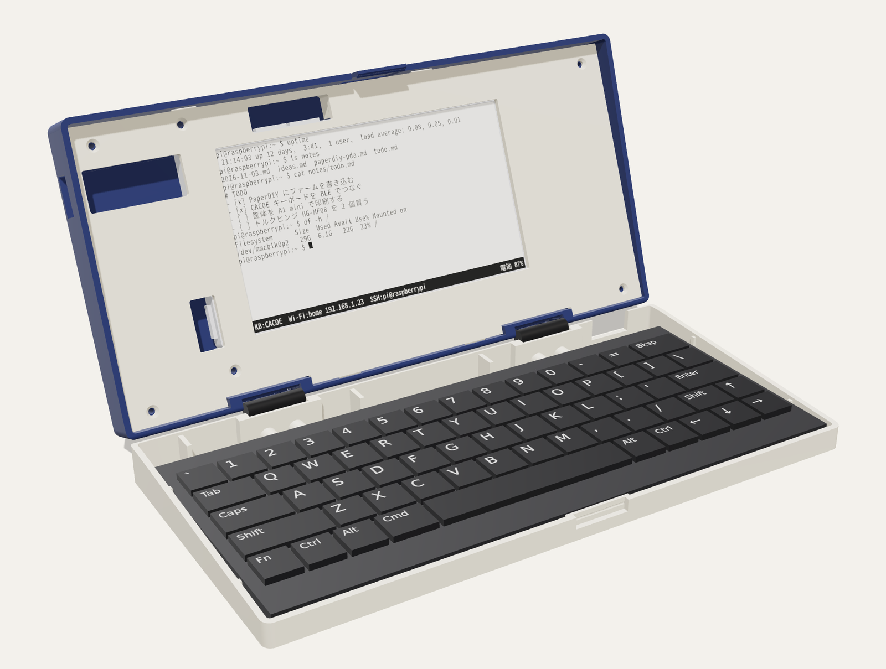
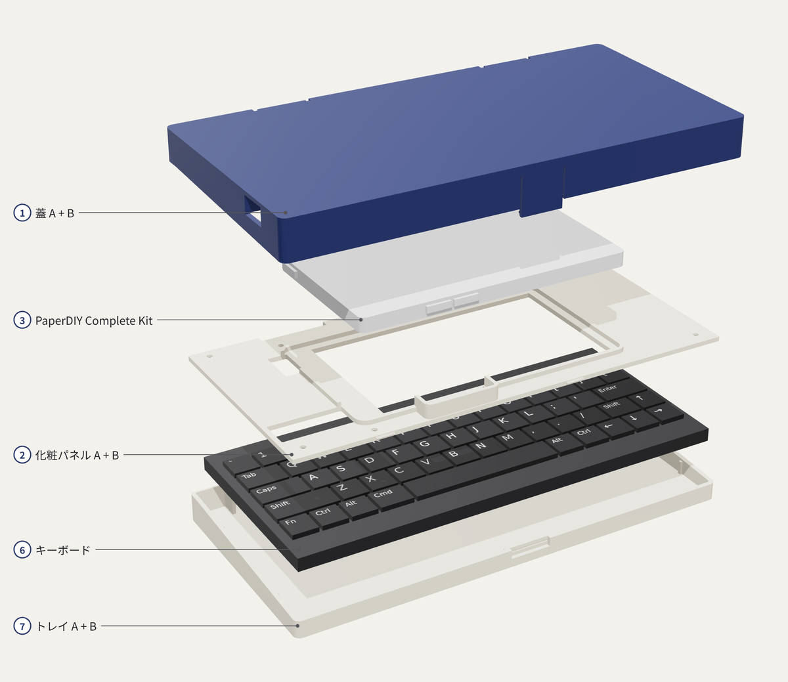
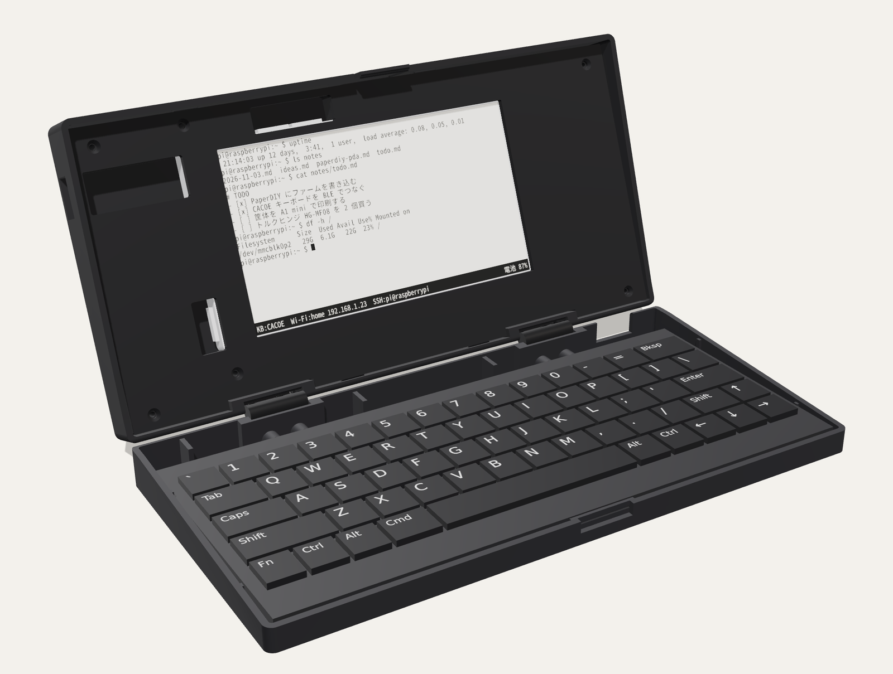
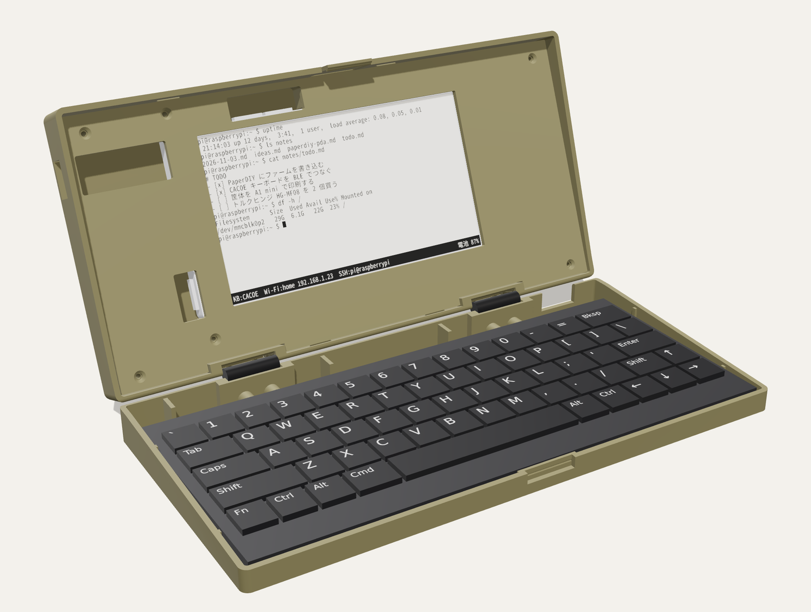
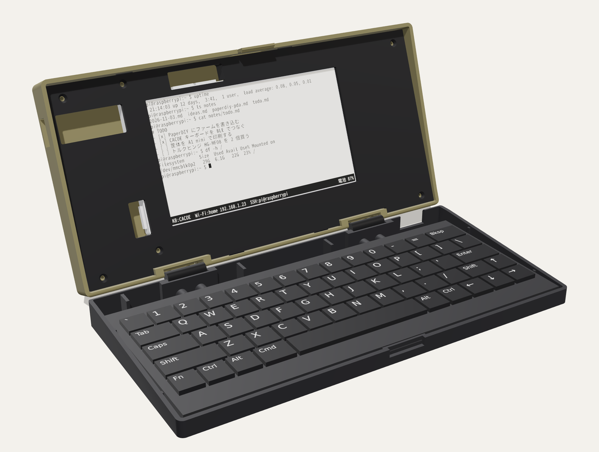
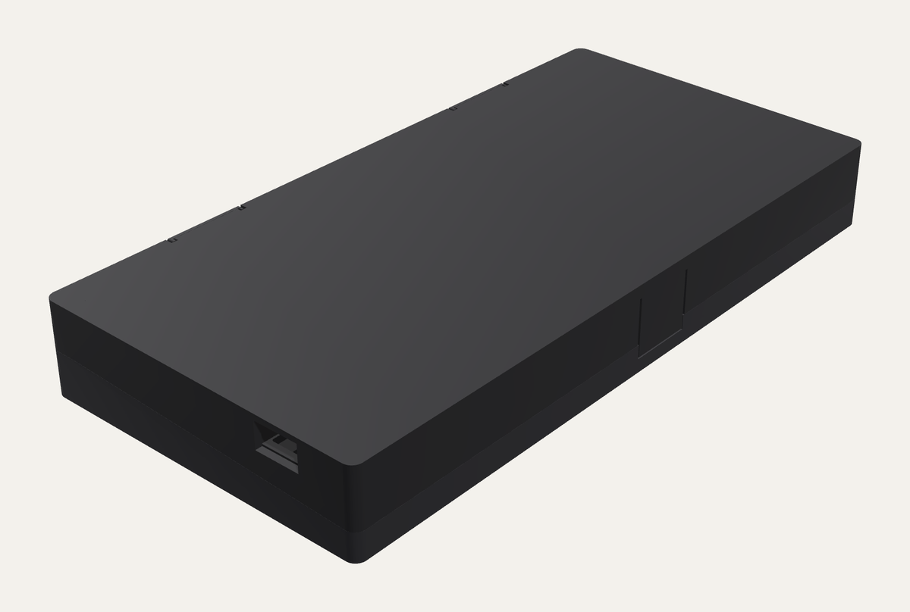
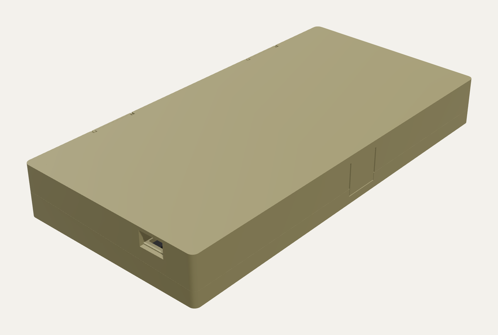
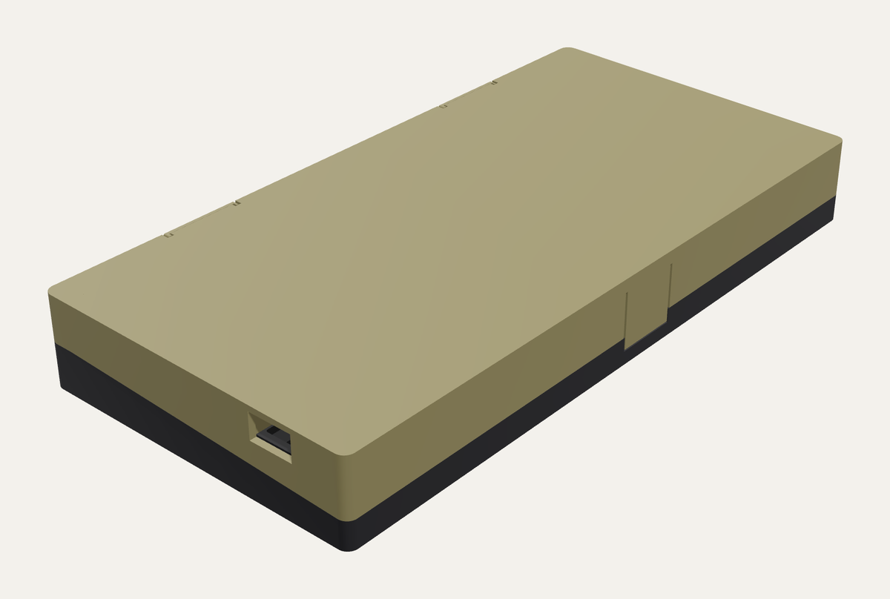
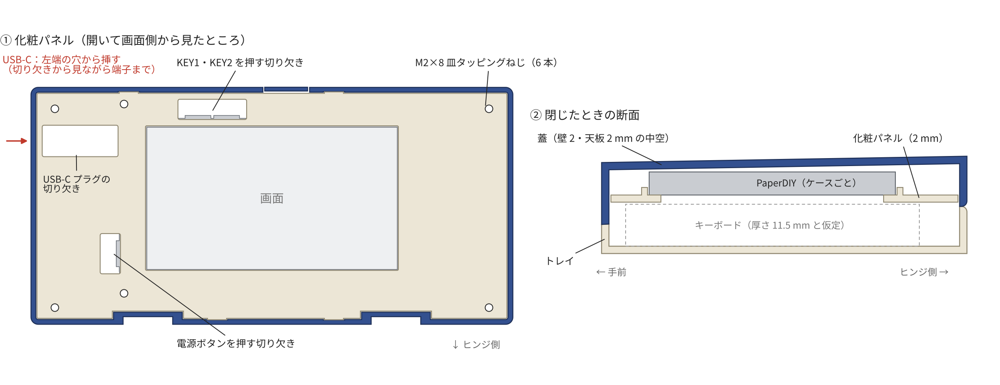
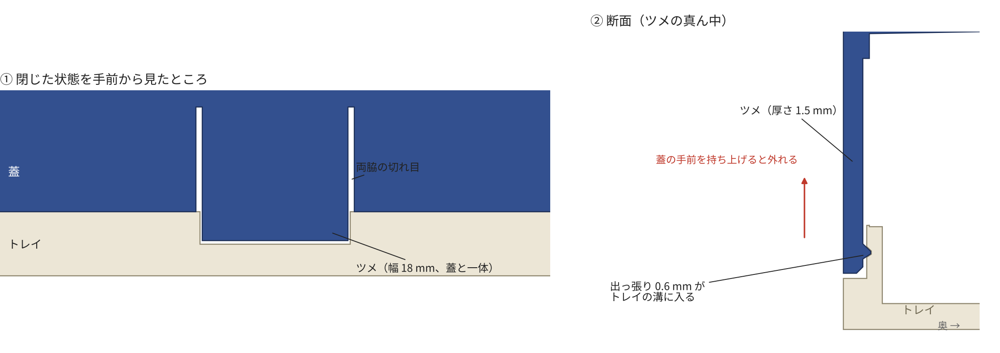

# PaperDIY PDA 筐体（3D プリント用データ）

Un Kyu Lee さんの [phone-enclosure](https://github.com/unkyulee/phone-enclosure)（Boox Palma 2 + CACOE キーボードのクラムシェル）を元に、画面側を **M5Stack PaperDIY** に置き換えた筐体です。

- PaperDIY は **Complete Kit のケースに入れたまま**、中空の薄い蓋に入れ、画面の窓のある**化粧パネル**で押さえて M2×8 のねじ 6 本で留めます。パネルは押し込むと前後の縁の突起 4 か所が蓋の壁の溝にパチンとはまるので、ねじなしでもある程度留まります。電池はキット内蔵の 140 mAh の LiPo で、足りないときは USB-C にモバイルバッテリーをつなぎます
- **試作は Bambu Lab A1 mini、製品は JLC3DP に発注**する前提で、作りやすさを優先しています。蓋とトレイは JLC の FDM の設計ガイドに合わせて壁・天板・床とも 2.0 mm の薄い殻にし、強さはヒンジのボスとリブで出しています。組み合わせる部品のすき間は片側 0.5 mm、細い部分（リブ・ツメ・ガード）は 1.5 mm 以上、面取りはなし、角の丸みは元の半分（R3）、サポートは要りません
- 閉じた全体の高さは手前 24.8 mm・奥 26.6 mm です（前の設計は 30 mm）。キーボードの厚さを測って入れれば、さらに下げられます
- ボタン（KEY1・KEY2・電源）は化粧パネルの切り欠きから指で直接押せます。KEY の切り欠きのまわりには、パネルの裏にガード（壁）があり、切り欠きから落ちたごみが蓋の中に入りにくくしてあります。USB-C は左端の穴から直接挿します。あとからパネルマウントのメス端子に替えたいときは、**蓋の左端の小片（蓋 A）だけ**を刷り直します
- 閉じた蓋は、蓋と一体の**留めツメ**がトレイのくぼみに掛かってパチンと留まります。磁石や後付けの部品は要りません
- ヒンジは、市販のトルクヒンジ（スガツネ HG-MF08）2 個を背面に埋め込み、背面と面一のカバーで隠しています。カバーはヒンジのねじで共締めします。開いたときの画面とキーボードの間の継ぎ目は 1〜1.5 mm です
- **Bambu Lab A1 mini（180 mm）** で刷れるよう、蓋・トレイ・化粧パネルは 2 分割して、蟻ほぞと、裏から貼る**継ぎ板**でつなぎます。印刷は 3 枚で約 4 時間・PLA 152 g です。造形範囲が 220 mm 角以上のプリンター用と、JLC3DP への発注用に、分割しない一体の版もあります（3 時間 46 分・151 g、貼り合わせ不要）
- ねじは **M2×8 皿タッピングねじ 14 本だけ**です（ヒンジ 8、化粧パネル 6）
- 本番の前に、**25 分の試し刷り**でヒンジ・蟻ほぞ・留めツメ・カバーのはめあいを確かめられます

> **この版はまだ印刷も仮組みもしていません**（前の版は印刷して組み、そこで分かったキーボードのがたつきや開いたときのすき間をこの版で直しました）。 データ上のチェック（全 STL が閉じた 1 個の立体、各部品 175 mm 以下、閉じた状態で部品同士・キーボードの入る空間・USB-C のプラグ・メス端子が重ならない、蓋を 0〜180° 回しても当たらない、留めツメの曲がりとひずみ、充電プラグが当たらない）と、スライサー（PrusaSlicer）でのスライス、壁の厚さ、倒れやすさの見積もりまでは済んでいます。





**部品表・印刷設定・組み立て手順は [ASSEMBLY_ja.md](ASSEMBLY_ja.md)**（部品表の CSV：[bom.csv](bom.csv)）にまとめました。寸法の根拠と全パラメータは英語版の [README.md](README.md) にあります。

## 印刷するファイル

| ファイル | 中身 | 時間・PLA の目安 |
| --- | --- | --- |
| `3mf/plate0_test_coupons.3mf` | 試し刷り（ヒンジ、蟻ほぞ、留めツメ、カバー） | 25 分・8 g |
| `3mf/plate1_lid.3mf` | 蓋 A・B、蓋側のヒンジカバー 2 枚、蓋の継ぎ板 2 枚 | 1 時間 45 分・67 g |
| `3mf/plate2_tray.3mf` | トレイ A・B、トレイ側のヒンジカバー 2 枚、トレイの継ぎ板 1 枚 | 1 時間 31 分・58 g |
| `3mf/plate3_panel.3mf` | 化粧パネル A・B、パネルの継ぎ板 3 枚 | 46 分・27 g |
| `3mf/usb_variants/lid_A_left_usb○○mm.3mf` | メス端子用の蓋 A（ねじ間隔 16〜30 mm、ねじなし） | 必要なときだけ |
| `3mf/large/plate1_lid.3mf`〜`plate3_panel.3mf` | **大きいプリンター用**（造形範囲 220 mm 角以上）：蓋・トレイ・化粧パネルを分割せず一体で。貼り合わせ不要 | 合計 3 時間 46 分・151 g |
| `3mf/large/usb_variants/lid_usb○○mm.3mf` | 大きいプリンター用の、メス端子用の蓋（一体） | 必要なときだけ |

部品は印刷する向きにそろえて 180 × 180 mm のプレートに並べてあります。Bambu Studio で開けば、そのままスライスできます。時間と重さは PrusaSlicer に A1 mini に近い設定を入れて出した目安です（`out/print_report.md`）。個別の STL は `out/split/`（分割した部品とメス端子用の蓋 A。継ぎ板は `out/split/splice/`）、`out/whole/`（一体の蓋・トレイ・化粧パネルとメス端子用の一体の蓋）、`out/`（カバー、確認用の分割前の蓋・トレイ・化粧パネル、キットの外形）、`out/coupons/`（試し刷り）にあります。

## JLC3DP に発注するとき（製品版）

分割しない一体の部品を使います。寸法・すき間は JLC の設計ガイド（FDM：壁 2.0 mm 以上、組み合わせのすき間 0.5 mm、公差 ±0.3 mm、細部 1.5 mm 以上）に合わせてあります。

| 部品 | STL | 数 | 頼み方 | 外形 |
| --- | --- | --- | --- | --- |
| 蓋 | `out/whole/lid.stl`（メス端子にするなら `out/whole/usb_variants/` のどれか） | 1 | FDM・PLA | 202 × 99.5 × 22.2 mm |
| トレイ | `out/whole/tray.stl` | 1 | FDM・PLA | 202 × 99.5 × 12.9 mm |
| 化粧パネル | `out/whole/panel.stl` | 1 | 樹脂（SLA）か MJF | 197 × 96.2 × 8.3 mm |
| 蓋側のヒンジカバー | `out/hinge_cover_lid_x2.stl` | 2 | 樹脂か MJF | 25.1 × 2.1 × 10.1 mm |
| トレイ側のヒンジカバー | `out/hinge_cover_tray_x2.stl` | 2 | 樹脂か MJF | 25.1 × 2.1 × 9.2 mm |

化粧パネルとカバーは、JLC の FDM の最小サイズ（30 × 30 × 10 mm）より小さい（薄い）ので、樹脂か MJF で頼みます（樹脂の最小は 10 × 2 × 2 mm、MJF は 5 × 5 × 5 mm。カバーは縁のリップで奥行き 2.1 mm にしてあります）。分割版の継ぎ板と蟻ほぞは、一体の版にはありません。

## 色の組み合わせ

完成予想を 3 通り描きました（PLA の黒・カーキの色味はメーカーで違います）。

| 黒だけ | カーキだけ | ミックス（蓋がカーキ、トレイと化粧パネルが黒） |
| --- | --- | --- |
|  |  |  |
|  |  |  |

## 蓋と化粧パネル



- **蓋**：壁・天板とも 2.0 mm の中空の殻です。角の丸みは R3、面取りはありません。内側には、ヒンジの座（ねじのボスとリブ）、化粧パネルのねじのボス 6 本、キットの裏を受けるリブ 3 本、USB-C プラグのガイド 2 本（幅 1.6 mm）があります。分割版の蟻ほぞは天板の厚さの中に収め、前の版にあった天板の厚い部分はなくしました
- **トレイ**：これも壁・床とも 2.0 mm の殻です（前の版は元のトレイに背面を足したもので、床・壁 3 mm、背面はヒンジの面まで約 10 mm 詰まっていました）。キーボードは、壁の内側のリブ（手前 4・奥 3・左右 2 ずつ、幅 1.6 mm）で元のトレイと同じ位置に収まります。背面の充電口の開口、留めツメの受け、ヒンジの座もあります
- **化粧パネル**：厚さ 2.0 mm。画面の窓（キットの窓より片側 0.5 mm 大きく、角は直角）、キットのまわりに入る枠（高さ 2.0・幅 1.6 mm、すき間 0.5 mm）、皿穴 6 つ、ボタンと USB-C プラグの切り欠き。PaperDIY はパネルの枠と蓋のリブの間に挟まって動きません
- **キットの位置**：Complete Kit のケース（M5Stack が公開している 3D データで 120.0 × 67.0 × 6.3 mm、角の丸み 3 mm）を画面側を下にして置き、画面の中心が蓋の左右の中央に来る位置です。まわりのすき間は 0.5 mm です
- **ボタン**：KEY1・KEY2 は化粧パネルの上の縁寄り、電源は窓の左に、指が入る切り欠きがあり、キットのボタンキャップを指先で横に押します。切り欠きはキットの縁から 8 mm、ボタンの両端から 3 mm 先まで開けてあります（前の版は 6.5 mm・1.5 mm）。押し棒はありません
- **ボタンのガード**：KEY の切り欠きのまわりには、パネルの裏から PaperDIY の裏の高さまで、厚さ 1.6 mm の壁が立っています（切り欠きから 0.5 mm 離れ、キットの縁で閉じる）。切り欠きから落ちたごみはこの中にとどまり、蓋の中やヒンジのほうへ入りにくくなります。電源の切り欠きは、キットの左端と蓋の端の壁の間の空間（USB-C の通り道があり、パネルの USB-C の切り欠きでもともと外とつながっている）に開いているので壁を立てても効き目が薄く、メス端子の蓋 A ではその場所に端子の本体が来るので、ガードはありません
- **USB-C**：蓋の左端に 13 × 7.6 mm の穴があり、蓋の内側の 2 本のガイド（穴の両脇の壁から PaperDIY の端まで）が、プラグを端子まで案内します。分割版ではガイドも蓋 A と蓋 B の境目で切れていますが、貼り合わせると一直線につながります。化粧パネルはこの通り道の上を切り欠いてあり（幅 13.2 mm、左端から PaperDIY の端まで）、プラグが端子に入るのを見ながら指で押し込めます。まっすぐなプラグ（根元 12 × 6.5 mm まで）なら挿したまま閉じられます
- **メス端子に替える**：蓋 A をメス端子用（`usb_variants/`）に替えると、左端の奥寄り（y = 20）に 13 × 7 mm の開口と M3 のねじ穴が開きます。ねじ間隔は 16・18・20・22・25・28・30 mm とねじなし（接着）。ねじ耳と本体が化粧パネルと天板の間に収まる高さ 7.4 mm までの端子が入ります。延長ケーブルのオス側は、化粧パネルの切り欠きから PaperDIY の端子に抜き差しできます。蓋 B・化粧パネル・ほかの部品は同じです
- **高さ**：化粧パネルの面はキーボードの上 0.5 mm の高さです。天面は、背面でヒンジの板とカバーが収まる高さと、USB-C の通り道の上に 1.5 mm 残る高さを通る平面にしてあり、手前ほどわずかに低くなります。蓋の厚さは手前 16.9 mm・奥 13.6 mm です
- **キーボードの高さ**：いまのデータは、元の蓋と同じく、キーボードの厚さ 11.5 mm（キートップまで）を想定しています。測った値を `src/params.py` の `KB_THICK` に入れて作り直すと、蓋がそのぶん低くなります

## 留めツメ

- 蓋の手前の壁に、幅 18 mm・厚さ 1.5 mm のツメを切り出してあり、合わせ目から 3.6 mm 下まで伸びています。位置は真ん中から右へ 6 mm（化粧パネルの KEY のガードを避けるため）。トレイの手前の面には、ツメが収まるくぼみと溝があります
- ツメの内側の出っ張り（0.6 mm、すき間 0.3 mm）が、閉じるときにくぼみの面を押してツメを外へ 0.3 mm たわませ、溝に落ちてパチンと留まります。ツメは外へたわむので、キーボードの位置に関係なく働きます
- 計算では、開ける力はツメだけで約 6 N、閉じる力は約 8.4 N です。ひずみは 0.30 % で、積層をまたいで曲がる部品の目安（0.5 %）の内側です。蓋を開ける実際の弧に沿って回したときのたわみも検査しています
- トレイの手前の壁は、くぼみの裏で 1.2 mm、溝の裏で 0.85 mm しか残りません（キーボードの入る空間を元のトレイと同じにしたため）。試し刷りの小片で、溝の裏が割れないかも見てください
- 固さは試し刷りの小片で確かめ、`LATCH["bump"]` で調整できます



## ヒンジ

- **部品**：スガツネの [ミニフラットトルクヒンジ HG-MF08](https://search.sugatsune.co.jp/product/g/gHG-MF/) を 2 個。20 × 25 × 2.0 mm、トルクは 1 個 0.0784 N·m（±25%）のフリーストップ型です
- **トルクの見積もり**：蓋の側（PaperDIY Complete Kit・化粧パネル・カバー込みで約 140 g）を水平にしたときのモーメントは約 0.07 N·m です。2 個で 0.157 N·m なので、どの角度でも止まります
- **取り付け**：軸は背面の下端（蓋とトレイの合わせ目）にあり、板は背面の溝にはまります。溝はヒンジより片側 0.4 mm 大きくしてあります。前の版は奥行き 9.5 mm の詰まったブロックで受けていましたが、いまは溝のまわりに 2.0 mm の壁を回した座と、ねじ穴ごとのボス（Ø5.8 mm、ねじ先から 1.5 mm 先まで）と、それを天板・床につなぐリブで受けています。羽根を広げた幅が 25 mm あるので、閉じた全体の背の高さは 26 mm より低くできません（いまは 26.6 mm）
- **開いたときのすき間**：背面の壁は**全幅で**ヒンジの板と同じ面にそろえてあり、縁は軸から 0.15 mm なので、開いても継ぎ目は 1〜1.5 mm です（90° で 1.45 mm、150° で 0.96 mm）
- **合わせ目の丸み**：蓋の背面の下の縁と、トレイの背面の上の縁（ヒンジの軸に沿った縁）は R1.5 で丸めてあります。軸が背面の 0.15 mm 外しかないので、実物の軸が少し低いと角同士がこすれます。丸みがあれば、軸が 0.3 mm 低くても蓋とトレイが当たるのは 170° からです（机の上の限界 160° より先）
- **カバー**：厚さ 1 mm のカバーを背面のくぼみにはめ、背面と面一にします。左右の縁には幅 1 mm のリップがあり、くぼみの深い溝に 1.1 mm 入るので、カバー全体の奥行きは 2.1 mm です（カバーを丈夫にし、JLC の樹脂・MJF の最小 2 mm を満たす）。くぼみはカバーより片側 0.5 mm 大きく、カバーの縁の小さな突起（つぶしリブ、片側 2 本）がそのすき間を埋めて、押し込むだけでも留まります。カバーには M2 の皿穴が 2 つあり、裏にはそれぞれヒンジの板の皿穴にはまる円すいが付いています。ヒンジの M2×8 は、カバーの皿穴からヒンジの板を通ってケースに入るので、カバーとヒンジを一緒に留められます（接着剤は使いません）。そのぶんヒンジの板は 1 mm 深く沈めてあり、軸は背面の 0.15 mm 外です。外から見えるのは筒とねじの頭だけです
- **開く角度**：机の上では約 160° で蓋が机に当たり、そこが限界です。0〜180° のどこまで回しても部品同士は当たりません。ヒンジの軸の高さは公表値がないのでメーカーの 3D データから読んでいます

## キーボードの充電口

元のトレイには、背面の壁に CACOE の充電口用と思われる開口があり、新しいトレイにも同じ位置（床から 3 mm 上から）に開けてあります。プラグの条件は元の作品と同じです（根元の太い部分が幅 16 mm × 高さ 6.8 mm 以内）。充電ケーブルを挿したままだと、**蓋は 95° までしか開きません**（背面を全幅でヒンジの面にそろえたため）。

## 倒れやすさ

CACOE キーボードが **82 g 以上**なら、机に当たる約 160° まで開いても倒れません（前の設計は 156 g。壁を 2 mm にして蓋が少し重くなったので、ひとつ前の版の 60 g からは増えました）。詳しくは [ASSEMBLY_ja.md](ASSEMBLY_ja.md) の 4 章。

## データの作り直し

リポジトリのルートで：

```bash
make setup     # Python のパッケージ（バージョン固定、cad/requirements.txt）
make verify    # 元データを固定のコミットで取得 → STL・3MF を作り直し → コミット済みのものと比べる
make report    # （PrusaSlicer があれば）印刷時間・重さ・警告・壁の厚さ・倒れやすさ → out/print_report.md
make render    # 完成予想図（docs/images/render_*.png、色違いも）
```

- **元データの固定**：元のリポジトリはコミット `a21bfd6` に固定し、使う STL の SHA-256 を `src/params.py` に書いてあります。違うものを読もうとするとビルドが止まります（`tools/fetch_original.sh` が正しいものを取ってきます）
- **同じものが出る**：同じ PC なら、STL も 3MF も 1 バイトも違わないファイルができます。別の PC では計算の最後の桁の丸めでバイトが変わるファイルがありますが、形は一致します。`out/MANIFEST.json` に全ファイルの SHA-256 と体積・寸法を記録してあり、`make verify` はバイトが同じか、形が 0.01 mm / 0.01 % 以内で同じかを確かめます
- **CI**：GitHub Actions（`.github/workflows/build.yml`）で、push のたびに同じ確認をします

寸法と作り方の切り替えはすべて `src/params.py` にあります。キーボードの厚さは `KB_THICK`、壁の厚さは `WALL`、角の丸みは `CORNER_R`、留めツメは `LATCH`、蓋の殻は `SHELL_*`、継ぎ板は `SPLICE`、化粧パネルは `PANEL_*`、キットの寸法は `KIT_*`、メス端子の位置は `USB_PM_Y_KIT` です。`KIT_LID = "solid"` にすると、中まで詰まった蓋のくぼみに PaperDIY をはめて天面から M2×4 のねじ 1 本で留める版（化粧パネルなし）、`PD_MOUNT = "bare"`（または環境変数 `PD_MOUNT=bare`）にすると前の設計（Assembly Kit の基板を画面パネルに載せ、2000 mAh の電池を入れる版。説明は英語の [README_bare.md](README_bare.md)）を作れます。形を変えたら `make manifest` で記録を更新します。

## ライセンス

筐体の 3D データ（`out/`、`3mf/`、`renders/`）と、それを描いた画像（`../docs/images/`）は、元データ「The PDA Terminal / phone-enclosure」（Un Kyu Lee、[CC BY-NC 4.0](https://creativecommons.org/licenses/by-nc/4.0/)）の改変物なので、**CC BY-NC 4.0（非営利のみ）** です（[LICENSE.md](LICENSE.md)）。変更点は `README.md` の「Changes vs. the original」に書いてあります。データを作るスクリプト（`src/`、`tools/`）と文書は、リポジトリ全体と同じ [MIT ライセンス](../LICENSE) です。PaperDIY の寸法は M5Stack が公開している図面と構造データ（[M5_Hardware](https://github.com/m5stack/M5_Hardware) の K159-B）によります。
