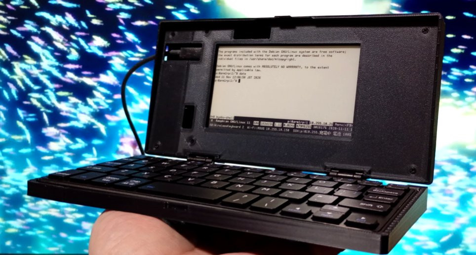

# v2026.11.11：最初のリリース（ファーム 0.3.2、筐体 2026-11-11 版）

M5Stack PaperDIY（4.7 型 e-paper、ESP32-S3）を画面に、CACOE キーボードを BLE でつないだ、PDA 風クラムシェルの SSH 端末の最初のリリースです。**ファーム 0.3.2** と、**筐体の 2026-11-11 時点の版**が入っています。

*English:* first release of a clamshell SSH terminal built from an M5Stack PaperDIY and a CACOE BLE keyboard: firmware 0.3.2 and the 3D-printed enclosure as of 2026-11-11. One device is built and in use (photo, 2026-11-11, an earlier revision whose snap does not catch). The enclosure is still a prototype: what the earlier prints showed is corrected here, but **this revision of the enclosure has not been printed yet**. Details in English: [cad/README.md](https://github.com/tsuyoshi-otake/paperdiy-pda-terminal/blob/v2026.11.11/cad/README.md).

> **実機が 1 台、組み上がって動いています**（写真、2026-11-11。留めツメを直す前の版）。CACOE キーボードの BLE 接続と自動ペアリング、Wi-Fi、Raspberry Pi への SSH ログインまで使えています。ただし、まだ試作段階です。筐体は、刷って組むたびに出た問題を直してきましたが、**このリリースの版そのものは、まだ刷って確かめていません**。本番の前に、約 28 分の試し刷り（plate 0）で確かめてください。

## ダウンロード

| ファイル | 中身 | 使う人 |
| --- | --- | --- |
| `paperdiy-pda-case-bambu-a1mini.zip` | Bambu Studio のプロジェクト 4 つ（試し刷り、蓋、トレイ、化粧パネル）と、同じ設定のプロセス | **Bambu Lab A1 mini・0.4 mm ノズル**で刷る人。開いてスライスするだけ |
| `paperdiy-pda-case-3mf.zip` | 形だけの 3MF：A1 mini 用の分割版、220 mm 角以上のプリンター用の一体版、メス端子用の蓋 | ほかのプリンター・スライサーで刷る人 |
| `paperdiy-pda-case-stl.zip` | 個別の STL | 自分で並べたい人 |
| `paperdiy-term-firmware-0.3.2.zip` | ファーム（`paperdiy-term-merged.bin`、`paperdiy-term-app.bin`、`SHA256SUMS`、ビルド条件、ライセンス表示） | 全員 |
| `SHA256SUMS` | 上の 4 つの zip の SHA-256 | |

zip の中身は、このタグのリポジトリの `cad/3mf/`・`cad/out/`・`firmware/prebuilt/` と同じです（`make dist` で作れます）。

## 作り方

1. **試し刷り**：plate 0（約 24 分・10 g）で、ヒンジとカバーのはめあい、留めツメの留まり具合を確かめる
2. **本番**：plate 1〜3（PLA 約 150 g、0.4 mm ノズルで約 4 時間。サポート不要）
3. **ファームを書く**：[firmware/README.md](https://github.com/tsuyoshi-otake/paperdiy-pda-terminal/blob/v2026.11.11/firmware/README.md)（ブラウザからでも書けます）
4. **組み立てる**：[組み立てガイド](https://github.com/tsuyoshi-otake/paperdiy-pda-terminal/blob/v2026.11.11/cad/ASSEMBLY_ja.md)（部品表、印刷設定、手順）

買うもの：M5Stack PaperDIY Complete Kit、CACOE キーボード、スガツネ HG-MF08 × 2、M2×8 皿タッピングねじ 14 本。

## この版の筐体

- 蓋とトレイは壁・天板・床とも 2.0 mm の殻。PaperDIY は Complete Kit のケースに入れたまま蓋に入れ、化粧パネルで押さえる
- 留めツメは蓋と一体で、幅 30 mm。切れ目はなく、まわりの壁を薄くした帯が板としてたわむ。トルクヒンジは手を離すと少し戻るので、蓋はカチッと言うまで押し込んで閉じる
- 蓋の下面は、ヒンジに向かって 0.4 mm まで斜めに逃がしてある。ヒンジのそばで蓋とトレイの縁が当たると、ねじを締めたときに蓋の手前が開くため（実機で起きた）
- トレイのキーボードの入る所は元の作品と同じ 196 × 87 mm。位置決めのリブはない（刷ってみて、干渉する・きついと分かったのでやめた）。底は平らで、足はない
- 部品はすべて PLA。ねじは 1 種類だけ
- A1 mini（180 mm）用の分割版は、継ぎ目を裏から継ぎ板で貼る。220 mm 角以上なら一体で刷れる

これまでの変更は [CHANGELOG.md](https://github.com/tsuyoshi-otake/paperdiy-pda-terminal/blob/v2026.11.11/CHANGELOG.md) にあります。

## まだ確かめていないこと

- この版の筐体の印刷と仮組み。とくに、蓋の下面をヒンジ側で逃がしたことで、ヒンジのねじを締めても蓋が開かなくなるか、留めツメがカチッと掛かって留まるか、開けにくくないか（留めツメは試し刷りの小片で確かめられます）。閉じるところのシミュレーション（`cad/out/snap_sim.md`）では、蓋が図面の位置から 0.2 mm 手前までなら留まり、0.4 mm 手前では掛かりません
- Bambu Studio のプロジェクトが、実際の Bambu Studio で設定どおりに開くか（公開されているソースの読み込み処理に合わせて作ったもので、作る側では Bambu Studio を動かせていません。開いたら、プリンタ・プレート・フィラメント・プロセスの 4 つの欄を確かめてください）
- CACOE の厚さと重さ（厚さ 11.5 mm までの想定。83 g 以上なら蓋をどこまで開いても倒れない計算）
- 日本語の入力は未対応です（[Issue #1](https://github.com/tsuyoshi-otake/paperdiy-pda-terminal/issues/1)）

## ライセンス

- ソースコードと文書：MIT
- 筐体の 3D データ（3 つの `paperdiy-pda-case-*.zip`）：**CC BY-NC 4.0（非営利のみ）**。Un Kyu Lee さんの [phone-enclosure](https://github.com/unkyulee/phone-enclosure) の改変物です
- ビルド済みのファームに入っているライブラリの表示は、zip の中の `THIRD_PARTY_NOTICES.md` にあります
